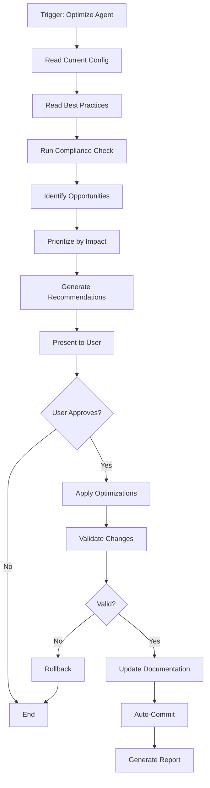

# ⚡ Skill: Agent Optimizer

**Purpose:** Optimize existing agents for best practices, performance, and compliance.

**Owner:** IDEX Agent

**Version:** 1.0

---

## 📋 Overview

This skill enables systematic optimization of existing IDEX agents to ensure they follow current best practices and maintain high quality. It handles:
1. **Compliance Analysis** - Check against latest standards
2. **Performance Optimization** - Improve agent effectiveness
3. **Configuration Refinement** - Enhance clarity and precision
4. **Documentation Alignment** - Keep docs in sync with implementation
5. **Skill Consolidation** - Reduce redundancy

---

## 🎯 Optimization Areas

### 1. File Restriction Optimization

**Goal:** Ensure file restrictions are precise and enforced.

**Checks:**
- Using tuple format (not array shorthand)
- Regex patterns are specific (not overly broad)
- Descriptions are clear
- Restrictions match agent role

**Example Optimization:**
```yaml
# Before (Too Broad)
groups:
  - read
  - - edit
    - fileRegex: .*
      description: All files

# After (Optimized)
groups:
  - read
  - - edit
    - fileRegex: \.(md|yaml|yml)$
      description: Configuration and documentation files only
```

### 2. Tool Group Optimization

**Goal:** Ensure agents have appropriate tool access.

**Checks:**
- All necessary tool groups present
- No unnecessary tool groups
- Proper ordering (read first, edit with restrictions)
- NOTE: browser group is NOT available in IDEX (Roo Code only)

**Example Optimization:**
```yaml
# Before (Missing Browser)
groups: [read, command, edit, mcp]

# After (Optimized)
groups:
  - read
  - browser  # Added for research
  - command
  - - edit
    - fileRegex: \.md$
      description: Markdown files only
  - mcp
```

### 3. Instruction Clarity

**Goal:** Make instructions clear, concise, and actionable.

**Checks:**
- Instructions are specific
- No redundancy
- Clear constraints
- Proper skill references
- Organized structure (CONSTRAINT, MINDSET, TOOLING, SKILLS)

**Example Optimization:**
```yaml
# Before (Verbose)
customInstructions: >-
  You should write specifications and not code. You should not edit
  Go files or Terraform files. You should use Context7 for documentation.
  You should use Atlassian for Jira and Confluence. You should maintain
  AGENTS.md. You should refer to various skill files.

# After (Optimized)
customInstructions: >-
  CONSTRAINT: You write SPECS, not CODE. Do not edit .go/.tf files.
  TOOLING: Use Context7 for docs, Atlassian for Jira/Confluence.
  MEMORY: Maintain AGENTS.md.
  SKILLS: .roo/skill-product-mastery.md, .roo/skill-roadmap.md
```

### 4. Trigger Optimization

**Goal:** Ensure triggers are effective for Orchestrator routing.

**Checks:**
- Triggers are specific (not too generic)
- No duplicate triggers across modes
- Cover all common use cases
- Avoid overlapping with other modes

**Example Optimization:**
```yaml
# Before (Too Generic)
triggers:
  - "Help"
  - "Question"
  - "Task"

# After (Optimized)
triggers:
  - "Strategy"
  - "Roadmap"
  - "PRD"
  - "Requirements"
  - "Feature Definition"
```

### 5. Model Assignment Optimization

**Goal:** Ensure optimal model for agent's role.

**Checks:**
- Model matches agent complexity
- Cost-effectiveness considered
- Performance requirements met

**Optimization Rules:**
```markdown
# Technical/Architectural Work
claude-sonnet-4-5 → Best for complex reasoning, architecture

# Creative/Marketing Work
gemini-3-pro-preview → Best for creative writing, marketing

# Code Analysis
claude-3-5-sonnet-20241022 → Best for code review, analysis

# General Purpose
claude-sonnet-4-5 → Default choice
```

### 6. Property Completeness

**Goal:** Ensure all recommended properties are present.

**Checks:**
- `description` property present
- `whenToUse` property present
- `roleDefinition` is detailed
- `customInstructions` are structured

**Example Optimization:**
```yaml
# Before (Missing Properties)
- slug: product-manager
  name: Product Manager
  roleDefinition: PM
  groups: [read, edit, mcp]

# After (Complete)
- slug: product-manager
  name: 💎 Product Manager
  description: Principal Product Manager for strategy and requirements
  roleDefinition: >-
    You are a Principal Product Manager specializing in B2B SaaS.
    You own the "What" and define product direction.
  whenToUse: >-
    Use for strategy, roadmap planning, PRD creation, requirement
    gathering, and feature definition.
  groups:
    - read
    - browser
    - command
    - - edit
      - fileRegex: \.md$
        description: Markdown files only
    - mcp
```

### 8. Feedback Analysis

**Goal:** Incorporate user feedback into agent definitions.

**Checks:**
- Review `docs/memory/shared/systemPatterns.md` section `## 📉 Feedback & Improvements`
- Identify recurring feedback for specific agents
- Convert feedback into `customInstructions` or `constraints`

**Example Optimization:**
```yaml
# Feedback: "PM diagrams are too complex"
# Optimization:
customInstructions: >-
  CONSTRAINT: Keep diagrams simple (max 10 nodes).
```


### 7. Skill Consolidation

**Goal:** Reduce redundancy and improve maintainability.

**Checks:**
- No duplicate skill content
- Skills are properly scoped
- Skills are reusable across modes
- Skill references are accurate

**Example Optimization:**
```markdown
# Before (Redundant)
.roo/skill-product-manager-saas.md
.roo/skill-architect-saas.md
.roo/skill-marketing-saas.md

# After (Consolidated)
.roo/skill-saas-wisdom.md  # Shared by all roles
```

---

## 🔧 Optimization Protocol

### Step 1: Analysis Phase

```markdown
1. Read current agent configuration
2. Read latest best practices:
   - docs/knowledge/platform/roocode_reference.md
   - docs/knowledge/platform/idex_reference.md
   - docs/plans/idex_compliance_report.md
3. Run compliance validation
4. Analyze feedback in `docs/memory/shared/systemPatterns.md`
4. Identify optimization opportunities
5. Prioritize by impact
```

### Step 2: Recommendation Phase

```markdown
FOR EACH optimization_opportunity:
  GENERATE:
    - Current state
    - Recommended state
    - Rationale
    - Impact (High/Medium/Low)
    - Effort (High/Medium/Low)
  
  PRIORITIZE by:
    - Compliance issues (Critical)
    - High impact, low effort (Quick wins)
    - High impact, high effort (Strategic)
    - Low impact (Nice to have)
```

### Step 3: Approval Phase

```markdown
1. Present recommendations to user
2. Explain each optimization
3. Get user approval for changes
4. Allow user to select which optimizations to apply
```

### Step 4: Implementation Phase

```markdown
FOR EACH approved_optimization:
  1. Apply changes
  2. Validate changes
  3. IF validation fails:
     - Rollback
     - Report issue
  4. ELSE:
     - Continue to next optimization
```

### Step 5: Validation Phase

```markdown
1. Run full validation on optimized configuration
2. Check for new conflicts
3. Verify all changes applied correctly
4. Generate optimization report
```

### Step 6: Documentation Phase

```markdown
1. Update AGENTS.md if role changed
2. Update skill files if referenced
3. Update compliance report
4. Auto-commit with detailed message
```

---

## 📊 Optimization Report Format

```markdown
# Agent Optimization Report

**Agent:** {mode_slug}
**Date:** {timestamp}
**Optimizer:** IDEX Agent

---

## 📊 Summary

**Optimizations Applied:** {count}
**Compliance Score Before:** {before_score}/100
**Compliance Score After:** {after_score}/100
**Improvement:** +{delta} points

---

## ✅ Optimizations Applied

### 1. {Optimization Name}
**Category:** {category}
**Impact:** {High/Medium/Low}
**Effort:** {High/Medium/Low}

**Before:**
```yaml
{before_code}
```

**After:**
```yaml
{after_code}
```

**Rationale:** {explanation}

---

## 📈 Metrics

| Metric | Before | After | Change |
|--------|--------|-------|--------|
| Compliance Score | {before} | {after} | +{delta} |
| File Restriction Precision | {before} | {after} | +{delta} |
| Instruction Clarity | {before} | {after} | +{delta} |
| Tool Group Optimization | {before} | {after} | +{delta} |

---

## 🎯 Remaining Opportunities

{List of optimizations not yet applied}
```

---

## 🛠️ Optimization Examples

### Example 1: Product Manager Optimization

**Before:**
```yaml
- slug: product-manager
  name: Product Manager
  model: gemini-3-pro-preview
  roleDefinition: Principal Product Manager. Strategy & Requirements.
  triggers: ["Strategy", "Roadmap", "PRD"]
  groups: [read, command, edit, mcp]
  customInstructions: >-
    CONSTRAINT: You write SPECS, not CODE. Do not edit .go/.tf files.
    MINDSET: Apply "B2B SaaS Wisdom" (ROI, COGS).
```

**Optimizations Identified:**
1. Missing `description` property (Medium impact, Low effort)
2. Missing `whenToUse` property (Medium impact, Low effort)
3. File restrictions not using tuple format (High impact, Low effort)
4. Missing `browser` tool group (Medium impact, Low effort)
5. Name missing emoji (Low impact, Low effort)

**After:**
```yaml
- slug: product-manager
  name: 💎 Product Manager
  description: Principal Product Manager for strategy and requirements
  model: gemini-3-pro-preview
  roleDefinition: >-
    You are a Principal Product Manager specializing in B2B SaaS.
    You own the "What" and define product direction, features, and specs.
  whenToUse: >-
    Use for strategy, roadmap planning, PRD creation, requirement gathering,
    specs validation, ROI analysis, and feature definition.
  triggers: ["Strategy", "Roadmap", "PRD", "Requirements", "Specs"]
  groups:
    - read
    - browser
    - command
    - - edit
      - fileRegex: \.md$
        description: Markdown files only (specs, docs, plans)
    - mcp
  customInstructions: >-
    CONSTRAINT: You write SPECS, not CODE. Do not edit .go/.tf files.
    MINDSET: Apply "B2B SaaS Wisdom" (ROI, COGS).
    TOOLING: Use Context7 for docs, Atlassian for Jira/Confluence.
    SKILLS: .roo/skill-product-mastery.md, .roo/skill-roadmap.md
```

**Impact:**
- Compliance score: 60% → 95% (+35%)
- File restrictions now enforced
- Better Orchestrator routing
- Improved user experience

### Example 2: Security Guardian Optimization

**Before:**
```yaml
- slug: security-guardian
  name: Security Guardian
  model: gemini-3-pro-preview
  roleDefinition: Cloud Security Consultant. Zero Trust & Compliance.
  triggers: ["Security", "Risk", "Audit"]
  groups: [read, command, mcp]
  customInstructions: >-
    TONE: Advisory. You are the "check and balance".
    MINDSET: Zero Trust. Assume the network is hostile.
```

**Optimizations Identified:**
1. Missing `description` property
2. Missing `whenToUse` property
3. Should have edit access for risk assessments (with restrictions)
4. Missing emoji in name
5. Triggers could be more comprehensive

**After:**
```yaml
- slug: security-guardian
  name: 🛡️ Security Guardian
  description: Cloud security consultant for compliance and risk assessment
  model: gemini-3-pro-preview
  roleDefinition: >-
    You are a Cloud Security Consultant specializing in Zero Trust architecture
    and compliance. You provide security guidance and risk assessments.
  whenToUse: >-
    Use for security reviews, risk assessments, compliance audits, CVE analysis,
    permission reviews, and security architecture validation.
  triggers:
    - "Security"
    - "Risk"
    - "Audit"
    - "Compliance"
    - "CVE"
    - "Permissions"
    - "RBAC"
    - "Zero Trust"
  groups:
    - read
    - command
    - - edit
      - fileRegex: \.md$
        description: Security documentation and risk assessments only
    - mcp
  customInstructions: >-
    TONE: Advisory. You are the "check and balance".
    MINDSET: Zero Trust. Assume the network is hostile.
    AUTHORITY: Veto power on compliance risks.
    SKILLS: .roo/skill-security-audit.md, .roo/skill-research.md
```

**Impact:**
- Can now create risk assessment documents
- Better trigger coverage
- Clearer role definition
- Improved compliance

---

## 🎯 Optimization Workflow



---

## 📋 Optimization Checklist

Use this checklist when optimizing agents:

### Configuration
- [ ] All required properties present (`slug`, `name`)
- [ ] All recommended properties present (`description`, `whenToUse`, `roleDefinition`)
- [ ] File restrictions use tuple format
- [ ] Regex patterns are specific and valid
- [ ] Tool groups are appropriate
- [ ] Model assignment is optimal

### Instructions
- [ ] Instructions are clear and concise
- [ ] Structured format (CONSTRAINT, MINDSET, TOOLING, SKILLS)
- [ ] No redundancy
- [ ] All skill references are valid
- [ ] Constraints are explicit

### Triggers
- [ ] Triggers are specific
- [ ] Cover all common use cases
- [ ] No duplicates with other modes
- [ ] Not overly generic

### Documentation
- [ ] AGENTS.md updated if needed
- [ ] Skill files exist and are current
- [ ] Role definition is clear
- [ ] whenToUse is comprehensive

### Validation
- [ ] Syntax is valid
- [ ] Roo Code compliant
- [ ] IDEX compliant
- [ ] No conflicts with other modes

---

## 🚨 Common Optimization Patterns

### Pattern 1: Add Missing Properties

```yaml
# Always add these if missing:
description: {Short summary of agent purpose}
whenToUse: {When to use this agent}
roleDefinition: {Detailed role description}
```

### Pattern 2: Convert to Tuple Format

```yaml
# From:
groups: [read, command, edit, mcp]

# To:
groups:
  - read
  - command
  - - edit
    - fileRegex: {appropriate_pattern}
      description: {clear_description}
  - mcp
```

### Pattern 3: Add Browser for Research

```yaml
# If agent needs research capabilities:
groups:
  - read
  - browser  # Add this
  - command
  - mcp
```

### Pattern 4: Structure Instructions

```yaml
# From:
customInstructions: >-
  You should do X. You should not do Y. Use Z for A.

# To:
customInstructions: >-
  CONSTRAINT: Do not do Y.
  TOOLING: Use Z for A.
  APPROACH: Do X.
  SKILLS: .roo/skill-*.md
```

### Pattern 5: Add Emoji to Name

```yaml
# From:
name: Product Manager

# To:
name: 💎 Product Manager
```

---

## 📖 References

- **IDEX Reference:** [`docs/knowledge/platform/idex_reference.md`](../../knowledge/idex_reference.md)
- **Roo Code Reference:** [`docs/knowledge/platform/roocode_reference.md`](../../knowledge/roocode_reference.md)
- **Compliance Report:** [`docs/plans/idex_compliance_report.md`](../idex_compliance_report.md)
- **Validator Skill:** [`skill-idex-config-validator.md`](skill-idex-config-validator.md)

---

**Last Updated:** 2026-02-12  
**Maintained By:** IDEX Agent
