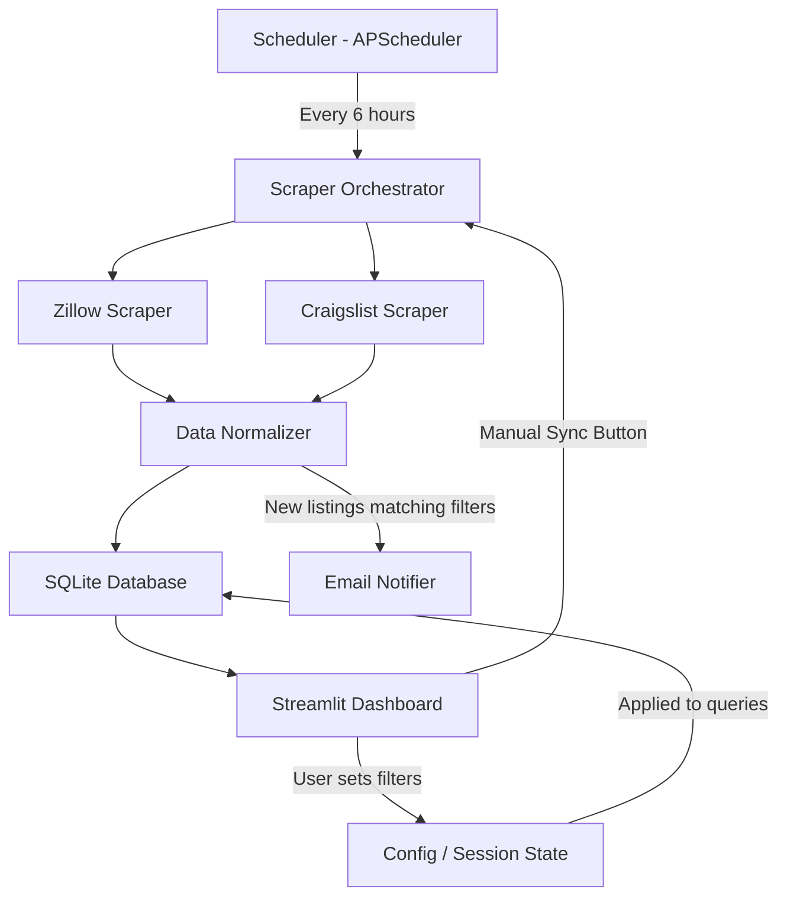

# Sunnyvale Rental Finder Agent - Architecture Plan

## Overview

A local Python application that automatically scrapes rental listings from Zillow and Craigslist for Sunnyvale, CA, stores them in a local SQLite database, and presents them through an interactive Streamlit dashboard with filtering, charts, and email notifications.

## Target User Profile

- **Location**: Sunnyvale, CA
- **Move-in date**: July 15, 2026
- **Budget**: $5,000 - $6,500/month
- **Bedrooms**: 3-4
- **Usage**: Personal/self-use, runs locally on laptop

---

## System Architecture



---

## Tech Stack

| Component | Technology | Why |
|-----------|-----------|-----|
| Language | Python 3.11+ | Simple, rich ecosystem for scraping and data |
| Dashboard | Streamlit | Fastest way to build interactive data dashboards, zero frontend code |
| Database | SQLite | Zero setup, file-based, perfect for local single-user app |
| ORM | SQLAlchemy | Clean data models, easy queries |
| Scraping | httpx + BeautifulSoup4 | Async HTTP + HTML parsing (Craigslist) |
| Zillow API | ZLLW Working API (RapidAPI) | Free tier, 500 req/month — replaces Playwright for Zillow |
| Scheduling | APScheduler | Lightweight, in-process job scheduler |
| Charts | Plotly via Streamlit | Interactive charts built into Streamlit |
| Map | Folium + streamlit-folium | Interactive map with markers for each listing |
| Geocoding | geopy (Nominatim) | Convert addresses to lat/lng for map pins, free and no API key needed |
| Email | smtplib + email.mime | Python standard library, no extra deps |
| Config | YAML file | Simple, human-readable configuration |

---

## Project Structure

```
zillow/
├── plans/
│   └── architecture.md
├── config.yaml                  # User configuration - filters, email, schedule
├── requirements.txt             # Python dependencies
├── README.md                    # Setup and usage instructions
├── app.py                       # Streamlit dashboard entry point
├── src/
│   ├── __init__.py
│   ├── models.py                # SQLAlchemy data models
│   ├── database.py              # Database connection and queries
│   ├── scrapers/
│   │   ├── __init__.py
│   │   ├── base.py              # Abstract base scraper
│   │   ├── zillow_scraper.py    # Zillow scraper implementation
│   │   └── craigslist_scraper.py # Craigslist scraper implementation
│   ├── orchestrator.py          # Coordinates scrapers, deduplication, scheduling
│   ├── geocoder.py              # Address to lat/lng conversion using geopy
│   ├── school_districts.py      # School district lookup by address/zip
│   ├── notifier.py              # Email notification service
│   └── utils.py                 # Shared utilities
├── data/
│   └── listings.db              # SQLite database file - auto-created
└── tests/
    └── ...
```

---

## Data Model

### Listing Table

| Column | Type | Description |
|--------|------|-------------|
| id | INTEGER PK | Auto-increment ID |
| external_id | TEXT | Unique ID from source site |
| source | TEXT | zillow or craigslist |
| url | TEXT | Direct link to listing |
| title | TEXT | Listing title |
| address | TEXT | Full address |
| neighborhood | TEXT | Neighborhood name |
| city | TEXT | City name |
| zip_code | TEXT | ZIP code |
| price | REAL | Monthly rent in USD |
| bedrooms | INTEGER | Number of bedrooms |
| bathrooms | REAL | Number of bathrooms |
| sqft | INTEGER | Square footage |
| sqm | REAL | Square meters - auto-calculated from sqft |
| property_type | TEXT | house, apartment, condo, townhouse |
| pet_friendly | BOOLEAN | Whether pets are allowed - nullable |
| parking | TEXT | Parking info - e.g. garage, street, none - nullable |
| laundry | TEXT | Laundry info - in-unit, shared, none - nullable |
| ac | BOOLEAN | Air conditioning available - nullable |
| furnished | BOOLEAN | Whether furnished - nullable |
| school_district | TEXT | Linked school district name |
| description | TEXT | Full listing description |
| image_urls | TEXT | JSON array of image URLs |
| latitude | REAL | Latitude for map pin |
| longitude | REAL | Longitude for map pin |
| available_date | DATE | Move-in availability date |
| listed_date | DATE | When the listing was posted |
| first_seen | DATETIME | When our scraper first found it |
| last_seen | DATETIME | When our scraper last confirmed it |
| is_active | BOOLEAN | Whether listing is still available |
| notified | BOOLEAN | Whether email was sent for this listing |

**Unique constraint**: `(source, external_id)` to prevent duplicates.

**Notes**:
- `sqm` is auto-calculated: `sqft * 0.092903`
- `image_urls` stores a JSON array of all listing image URLs
- `school_district` is looked up based on address/zip code using a local mapping table
- Nullable fields (pet_friendly, parking, laundry, ac, furnished) are optional amenity filters - empty by default

---

## Component Details

### 1. Scrapers

#### Zillow Scraper
- Zillow heavily protects against direct scraping (PerimeterX CAPTCHA). Strategy:
  - **Primary**: Use the **ZLLW Working API** on RapidAPI (`zllw-working-api.p.rapidapi.com`)
  - **Endpoint**: `GET /search/byaddress` with `listingStatus=For_Rent` and `sortOrder=Rental_Priority_Score`
  - **Free tier**: 500 requests/month (more than enough for daily scraping of ~51 Sunnyvale listings)
  - **Data**: Returns full listing JSON — price, beds, baths, sqft, lat/lng, photos, days on market, property type
  - **Pagination**: 200 results per page, max 5 pages. Current Sunnyvale search fits in 1 page
  - **Two result types**: `property` (single listing) and `propertyGroup` (apartment complex with multiple units)
- **Alternative fallback**: If the API becomes unavailable, consider Playwright stealth browser approach or Zillow daily email parsing

#### Craigslist Scraper
- Craigslist is simpler to scrape:
  - **Primary**: Use httpx for direct HTTP requests - Craigslist pages are mostly server-rendered HTML
  - **URL**: `https://sfbay.craigslist.org/search/apa` with query params for Sunnyvale area
  - **Parsing**: BeautifulSoup to extract listing data from search results
  - **Pagination**: Follow next page links until no more results

#### Base Scraper Interface
```python
class BaseScraper:
    async def scrape() -> list[RawListing]
    def normalize(raw: RawListing) -> Listing
```

### 2. Orchestrator

- Coordinates all scrapers
- Handles deduplication by checking `(source, external_id)` before insert
- Marks listings as inactive if not seen in last 2 scrape cycles
- Triggers email notifications for new listings matching user filters
- Provides a `run_sync()` method callable from the dashboard

### 3. Scheduler

- Uses APScheduler with `BackgroundScheduler`
- Default interval: every 6 hours
- Configurable via `config.yaml`
- Runs in a background thread alongside Streamlit

### 4. Email Notifier

- Uses Python `smtplib` with Gmail SMTP or any SMTP server
- Sends HTML-formatted email with listing details
- Only notifies for NEW listings that match the current filter criteria
- Tracks notification status in the `notified` column

### 5. Streamlit Dashboard

#### Layout

```mermaid
graph TD
    subgraph Dashboard
        A[Header: Sunnyvale Rental Finder]
        B[Sidebar: Filters Panel]
        C[Action Bar: Sync Now Button + Last Sync Time]
        D[Summary Metrics: Total Listings - Avg Price - New Today]
        M[Map View: Interactive Folium Map]
        E[Listing Cards Grid]
        F[Charts Section]
    end
    B --> B1[Primary Filters - always visible]
    B1 --> B1a[Price Range Slider]
    B1 --> B1b[Bedrooms Selector]
    B1 --> B1c[Bathrooms Selector]
    B1 --> B1d[Property Type Multi-select]
    B1 --> B1e[Source Filter]
    B --> B2[Optional Filters - collapsed by default]
    B2 --> B2a[Min/Max Sqft]
    B2 --> B2b[Pet Friendly toggle]
    B2 --> B2c[Parking type]
    B2 --> B2d[Laundry type]
    B2 --> B2e[AC toggle]
    B2 --> B2f[Furnished toggle]
    B2 --> B2g[School District]
    B2 --> B2h[Neighborhood]
    M --> M1[Color-coded markers by source]
    M --> M2[Popup with listing details]
    E --> E1[Listing Card with details]
    F --> F1[Price Distribution Histogram]
    F --> F2[Price by Bedrooms Box Plot]
    F --> F3[Listings by Source Pie Chart]
    F --> F4[New Listings Over Time Line Chart]
```



#### Sidebar Filters

**Primary filters** (always visible):
- Price range slider ($0 - $10,000, default: $5,000 - $6,500)
- Bedrooms selector (1-5+, default: 3-4)
- Bathrooms selector (1-4+)
- Property type multi-select (house, apartment, condo, townhouse)
- Source filter (All, Zillow, Craigslist)

**Optional filters** (collapsed in an expander, empty/off by default):
- Min/Max square footage
- Pet friendly (Yes/No/Any)
- Parking (Any, Garage, Street, None)
- Laundry (Any, In-unit, Shared, None)
- Air conditioning (Yes/No/Any)
- Furnished (Yes/No/Any)
- School district (dropdown)
- Neighborhood (dropdown)

#### Listing Card Design

Each listing is displayed as a card showing:

| Field | Display |
|-------|---------|
| **Price** | Large, prominent monthly rent - e.g. $5,800/mo |
| **Bedrooms** | Icon + count - e.g. 🛏 3 bed |
| **Bathrooms** | Icon + count - e.g. 🚿 2 bath |
| **Size** | Dual units - e.g. 1,850 sqft / 172 m² |
| **Pet Friendly** | 🐾 paw emoji shown when pet-friendly |
| **Neighborhood** | Name of the neighborhood |
| **School District** | Linked school district name |
| **Images** | Thumbnail + link to view all images in a modal/gallery |
| **Source** | Badge showing Zillow or Craigslist |
| **Link** | Button to open original listing in new tab |

#### Other Dashboard Features
- **Sync button**: Triggers immediate scrape with a spinner/progress indicator
- **Metrics row**: Total listings count, average price, median price, new listings today
- **Map view**: Interactive Folium map centered on Sunnyvale showing all filtered listings as markers. Each marker shows a popup with listing title, price, bedrooms, and a link to the full listing. Color-coded markers by source: blue for Zillow, orange for Craigslist
- **Charts**:
  - Price distribution histogram
  - Price vs. bedrooms box plot
  - Listings count by source - pie chart
  - New listings over time - line chart
  - Price per sqft distribution
  - Listings by neighborhood bar chart

---

## Configuration File (config.yaml)

```yaml
# Search parameters
search:
  city: Sunnyvale
  state: CA
  zip_codes:
    - "94085"
    - "94086"
    - "94087"
    - "94089"

# Default filters
filters:
  min_price: 5000
  max_price: 6500
  min_bedrooms: 3
  max_bedrooms: 4
  property_types:
    - house
    - townhouse
    - condo

# Scheduler
schedule:
  interval_hours: 6

# Email notifications
email:
  enabled: false
  smtp_server: smtp.gmail.com
  smtp_port: 587
  sender_email: ""
  sender_password: ""  # Use app-specific password for Gmail
  recipient_email: ""

# Scraper settings
scraper:
  request_delay_min: 3
  request_delay_max: 8
  max_pages: 5
```

---

## Key Design Decisions

1. **Streamlit over Flask/React**: Zero frontend code needed. Streamlit handles state, layout, and interactivity. Perfect for a personal tool.

2. **SQLite over PostgreSQL**: No server to manage. The database is just a file. For a single-user local app, SQLite is more than sufficient.

3. **Playwright for Zillow**: Zillow uses heavy JavaScript rendering and anti-bot measures. A headless browser is the most reliable approach.

4. **httpx for Craigslist**: Craigslist serves mostly static HTML, so a simple HTTP client is sufficient and faster.

5. **APScheduler in-process**: No need for Celery or external task queues. APScheduler runs in a background thread within the same Python process.

6. **YAML config**: Easy to edit by hand, supports comments, cleaner than JSON for configuration.

---

## Scraping Considerations and Ethics

- **Rate limiting**: All scrapers include random delays between requests to avoid overwhelming servers
- **Respect robots.txt**: Check and respect robots.txt directives
- **User-Agent**: Use realistic browser user agents
- **Terms of Service**: This is for personal use only. Both Zillow and Craigslist have ToS that restrict scraping. For personal, non-commercial use at low volume, this is generally acceptable
- **Fallback strategy**: If a scraper gets blocked, it logs the error and retries on the next cycle rather than hammering the server

---

## How to Run

```bash
# 1. Install dependencies
pip install -r requirements.txt
playwright install chromium

# 2. Edit config.yaml with your email settings (optional)

# 3. Run the dashboard
streamlit run app.py
```

The app will:
1. Start the Streamlit dashboard on `http://localhost:8501`
2. Start the background scheduler for automatic scraping every 6 hours
3. Allow manual sync via the dashboard button
4. Send email notifications when new matching listings are found (if configured)

---

## Dependencies (requirements.txt)

```
streamlit>=1.30.0
sqlalchemy>=2.0.0
httpx>=0.25.0
beautifulsoup4>=4.12.0
playwright>=1.40.0
apscheduler>=3.10.0
plotly>=5.18.0
pandas>=2.1.0
pyyaml>=6.0.0
lxml>=4.9.0
folium>=0.15.0
streamlit-folium>=0.18.0
geopy>=2.4.0
```

---

## Future Enhancements (Out of Scope for V1)

- Add more sources: Apartments.com, Redfin, Facebook Marketplace
- Favorite/bookmark listings
- Price history tracking for individual listings
- SMS notifications via Twilio
- Listing comparison side-by-side view
- Export to CSV/Excel
