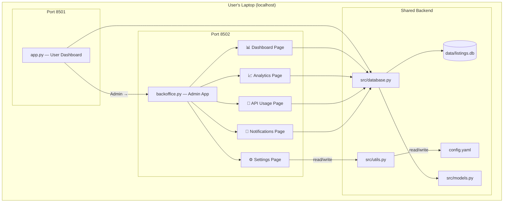
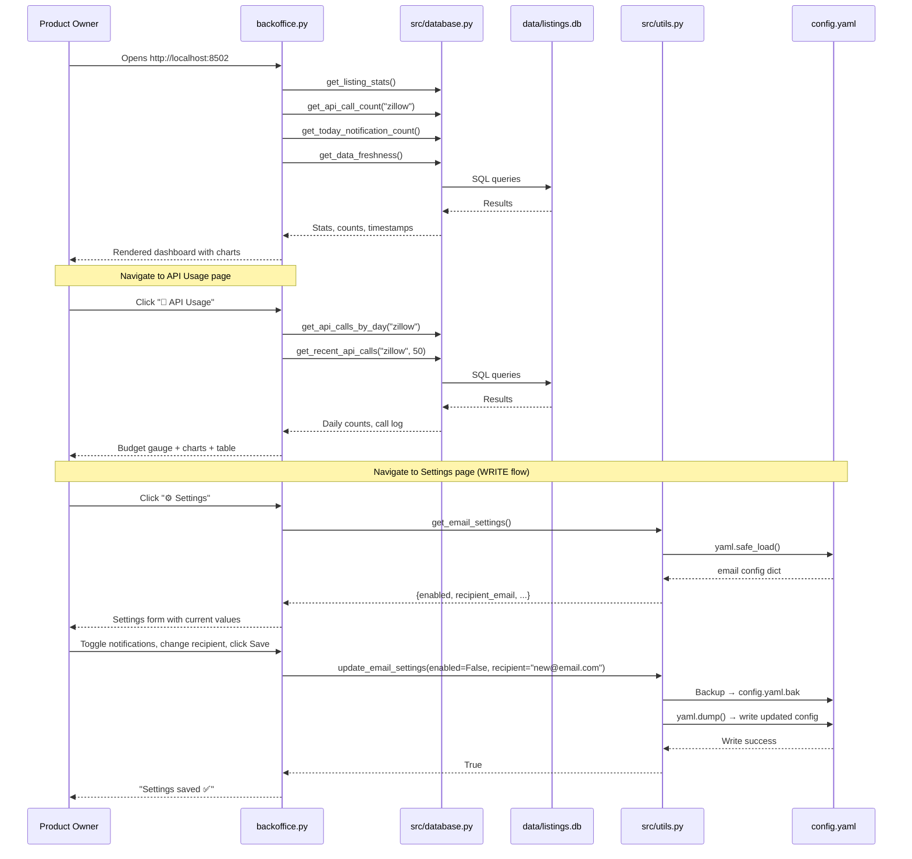

# SunnyNest Backoffice App — Architecture Plan

> **Author**: Architect Agent
> **Date**: 2026-03-28
> **Status**: Draft → **Revised** (user feedback incorporated)
> **Related**: [`plans/architecture.md`](../plans/architecture.md), [`docs/design/design-bible.md`](../docs/design/design-bible.md)

---

## 1. Overview

A **separate Streamlit admin app** for SunnyNest that provides operational visibility into the system: listing analytics, API usage monitoring, scraper health, notification history, and **notification settings management**. This is an internal tool — not user-facing — designed for the product owner to monitor and manage the rental aggregator.

### Goals
1. **Listing analytics** — aggregate stats, trends, price distributions, source breakdowns (including historical/inactive data)
2. **API budget monitoring** — Zillow RapidAPI call counter with 500 req/month budget tracking
3. **Scraper health** — last run status, success/failure rates, data freshness
4. **Notification audit** — email send history, success/failure rates
5. **Notification settings** — enable/disable notifications, manage recipient email from the UI (no manual `config.yaml` editing)

---

## 2. Architecture Decision: Separate Streamlit App

### Options Considered

| Option | Pros | Cons |
|--------|------|------|
| **A. Separate Streamlit app** ✅ | Clean separation of concerns; independent port; can restart without affecting user dashboard; simpler code per app | Two processes to manage; shared DB requires no write conflicts |
| B. Same app with page routing (`st.navigation`) | Single process; shared session state | Mixes admin and user concerns; user could accidentally navigate to admin pages; harder to maintain; bloats `app.py` further (already 1500+ lines) |
| C. Flask admin panel | More traditional admin UI; template-based | Adds Flask dependency; different tech stack from existing Streamlit; more code to write |

### Decision: **Option A — Separate Streamlit app on port 8502**

**Rationale:**
- [`app.py`](../app.py) is already 1500+ lines — adding admin pages would make it unwieldy
- The backoffice has fundamentally different concerns (ops monitoring vs. listing browsing)
- Separate process means the admin app can be restarted/updated without disrupting the user dashboard
- Both apps share the same SQLite database via the existing [`src/database.py`](../src/database.py) module — no new data layer needed
- Local single-user app, so no auth complexity — just a different port
- Streamlit's `st.navigation` multi-page feature would work but couples the codebases unnecessarily

---

## 3. File Structure

```
zillow/
├── app.py                          # User-facing dashboard (port 8501) — unchanged
├── backoffice.py                   # Admin app entry point (port 8502) — NEW
├── src/
│   ├── database.py                 # Shared — add new query functions here
│   ├── models.py                   # Shared — no changes needed
│   └── ...
├── scripts/
│   ├── start-dashboard.sh          # Existing — starts app.py on 8501
│   └── start-backoffice.sh         # NEW — starts backoffice.py on 8502
├── com.sunnynest.dashboard.plist   # Existing launchd for user dashboard
├── com.sunnynest.backoffice.plist  # NEW launchd for backoffice (REQUIRED — auto-start)
└── config.yaml                     # Shared config — backoffice reads AND writes email settings
```

The backoffice is a **single-file Streamlit app** (`backoffice.py`) that uses Streamlit's built-in `st.navigation` for multi-page routing within the admin app. All pages are defined as functions inside `backoffice.py` (or split into a `backoffice/` package if it grows beyond ~500 lines).

---

## 4. Pages & Features

### 4.1 📊 Dashboard (Home Page)

The landing page — a high-level operational overview with KPI cards and summary charts.

**KPI Cards Row:**
| Metric | Source | Existing? |
|--------|--------|-----------|
| Total active listings | [`get_listing_stats()`](../src/database.py:895) → `total` | ✅ Yes |
| Avg monthly rent | [`get_listing_stats()`](../src/database.py:895) → `avg_price` | ✅ Yes |
| New listings today | [`get_listing_stats()`](../src/database.py:895) → `new_today` | ✅ Yes |
| API calls this month / 500 | [`get_api_call_count("zillow")`](../src/database.py:833) | ✅ Yes |
| Notifications sent today | [`get_today_notification_count()`](../src/database.py:1032) | ✅ Yes |
| Data freshness | NEW: last `last_seen` timestamp across all listings | ❌ New query |

**Charts:**
- **Listings by source** — pie/donut chart from [`get_source_counts()`](../src/database.py:737)
- **API usage this month** — daily bar chart (NEW query: group `api_call_log` by date)
- **Price distribution** — histogram of active listing prices (NEW query)

---

### 4.2 📈 Listing Analytics

Deep-dive into listing data trends and distributions.

> **📌 Decision:** All analytics queries include **both active and inactive (historical) listings** unless explicitly scoped to active-only. This gives the product owner a complete picture of market trends over time, not just a snapshot of current inventory.

**Sections:**

1. **Price Trends Over Time**
   - Line chart: average price by month, split by bedroom count
   - Uses existing [`get_avg_price_by_period()`](../src/database.py:604) — **update to include inactive listings** (currently filters `is_active=1`)
   - Controls: bedroom count multi-select, period toggle (weekly/monthly), active/all toggle

2. **Price Distribution**
   - Histogram of **all** listing prices (active + inactive), with optional active-only filter
   - Box plot by bedroom count
   - NEW query: `get_price_distribution(include_inactive=True)`

3. **Source Breakdown**
   - Bar chart: listings per source (Zillow vs Craigslist)
   - Stacked bar: active vs inactive per source
   - Uses existing [`get_source_counts()`](../src/database.py:737) + NEW inactive variant

4. **Listings Inventory Over Time**
   - Line chart: total listings over time (by first_seen date), showing both active and total
   - NEW query: `get_listing_inventory_timeline()`

5. **Price Changes Summary**
   - Table: listings with price drops/increases (includes historical price changes)
   - Uses existing [`get_batch_price_changes()`](../src/database.py:560)
   - Sortable by change amount, percentage

6. **Geographic Heatmap** (stretch goal)
   - Folium choropleth by ZIP code showing avg price
   - Uses existing listing lat/lng data

---

### 4.3 🔑 API Usage

Dedicated page for Zillow RapidAPI budget monitoring.

**Components:**

1. **Budget Gauge**
   - Large circular gauge: `used / 500` calls this month
   - Color-coded: green (<60%), amber (60-80%), red (>80%)
   - Uses [`get_api_call_count("zillow")`](../src/database.py:833)

2. **Daily Usage Chart**
   - Bar chart: API calls per day for the current month
   - NEW query: `get_api_calls_by_day(service, month)`

3. **Monthly History**
   - Bar chart: API calls per month for the last 6 months
   - NEW query: `get_api_calls_by_month(service, months=6)`

4. **Call Log Table**
   - Scrollable table of recent API calls with timestamp, endpoint, status code
   - NEW query: `get_recent_api_calls(service, limit=50)`
   - Filterable by status code (success/error)

5. **Budget Projection**
   - Simple calculation: `(calls_so_far / days_elapsed) * days_in_month`
   - Warning banner if projected to exceed 500

**Config Display:**
- Current API host: from [`config.yaml`](../config.yaml) → `zillow_api.rapidapi_host`
- Budget limit: 500 (hardcoded constant, could move to config)
- Scrape frequency: from [`config.yaml`](../config.yaml) → `schedule.interval_hours`

---

### 4.4 🔔 Notifications

Audit trail for email notifications.

**Components:**

1. **Summary Cards**
   - Total notifications sent (all time)
   - Notifications today
   - Success rate (%)
   - Uses [`get_today_notification_count()`](../src/database.py:1032) + NEW aggregate query

2. **Notification History Table**
   - Columns: timestamp, channel, recipient, listing_count, success/fail
   - NEW query: `get_notification_history(limit=100)`
   - From [`NotificationLog`](../src/models.py:247) model

3. **Daily Send Chart**
   - Bar chart: notifications per day for the last 30 days
   - NEW query: `get_notifications_by_day(days=30)`

---

### 4.5 ⚙️ Settings

Manage notification settings from the backoffice UI — replaces manual [`config.yaml`](../config.yaml) editing.

**Components:**

1. **Notifications Toggle**
   - `st.toggle()` for enable/disable email notifications
   - Maps to `email.enabled` in [`config.yaml`](../config.yaml)
   - Shows current status with green/red indicator

2. **Recipient Email**
   - `st.text_input()` for the notification recipient email address
   - Maps to `email.recipient_email` in [`config.yaml`](../config.yaml)
   - Validates email format before saving (basic regex: `^[^@]+@[^@]+\.[^@]+$`)
   - Note: the `NOTIFICATION_RECIPIENT` env var takes precedence at runtime — show an info banner if the env var is set, explaining that the env var overrides the config value

3. **Save Button**
   - `st.button("Save Settings")` writes changes to [`config.yaml`](../config.yaml)
   - Shows `st.success()` confirmation on save
   - Shows `st.error()` if write fails (e.g., file permissions)

4. **Current Config Display** (read-only info)
   - SMTP server and port (from config — not editable, rarely changes)
   - Sender email (from config — not editable, tied to SMTP credentials)
   - Whether `NOTIFICATION_RECIPIENT` env var is set (boolean indicator)
   - Whether `SMTP_PASSWORD` env var is set (boolean indicator, no value shown)

**Persistence Approach: Direct `config.yaml` Write**

> **📌 Decision:** Store settings in [`config.yaml`](../config.yaml) via direct file write, not in SQLite.
>
> **Rationale:**
> - [`src/notifier.py`](../src/notifier.py) already reads from `config.yaml` — no code changes needed in the notification pipeline
> - Single source of truth — settings are in the same file the notifier reads
> - Simpler than adding a new SQLite `settings` table + migration + read logic in notifier
> - This is a local single-user app — no concurrent write concerns
> - Python's `yaml.safe_load()` / `yaml.dump()` handles round-trip cleanly
>
> **Trade-off:** File writes from a web app are unusual, but acceptable for a local admin tool. The backoffice is the only writer (besides manual editing), and writes are infrequent (settings changes, not per-request).

**Implementation Notes:**
- Use `yaml.safe_load()` to read, modify the `email` section, then `yaml.dump()` to write back
- Preserve comments where possible (consider `ruamel.yaml` for comment-preserving round-trip, but `PyYAML` is already a dependency and sufficient — comments will be lost on write, which is acceptable)
- Create a backup of `config.yaml` before writing (e.g., `config.yaml.bak`)
- The write function should be in [`src/database.py`](../src/database.py) or a new `src/config_manager.py` — recommend keeping it in a utility function alongside the existing [`load_config()`](../src/utils.py) in [`src/utils.py`](../src/utils.py)

---

### 4.6 🔧 System Health (stretch goal)

Operational monitoring — can be added in a later phase.

**Potential Components:**
- Scraper last-run timestamp and status
- Database file size
- Log file tail viewer (last 50 lines of `logs/dashboard-stderr.log`)
- Scheduler status (next run time)
- Manual scrape trigger button

---

## 5. New Database Queries & Utility Functions Needed

All new query functions go in [`src/database.py`](../src/database.py). They follow the existing pattern: use [`get_session()`](../src/database.py:128) context manager, return plain dicts/lists, use SQL aggregates where possible.

Settings persistence functions go in [`src/utils.py`](../src/utils.py) alongside the existing [`load_config()`](../src/utils.py).

### 5.1 New Database Queries

| Function | Returns | Used By |
|----------|---------|---------|
| `get_data_freshness()` | `datetime` — most recent `last_seen` across all active listings | Dashboard KPIs |
| `get_api_calls_by_day(service, month)` | `list[dict]` — `[{date, count}]` for each day in the month | API Usage page |
| `get_api_calls_by_month(service, months)` | `list[dict]` — `[{month, count}]` for last N months | API Usage page |
| `get_recent_api_calls(service, limit)` | `list[ApiCallLog]` — most recent API call records | API Usage page |
| `get_price_distribution(include_inactive)` | `list[float]` — listing prices for histogram (active-only or all) | Listing Analytics |
| `get_listing_inventory_timeline()` | `list[dict]` — `[{date, active_count, total_count}]` by first_seen date | Listing Analytics |
| `get_source_counts_with_inactive()` | `dict` — `{source: {active: N, inactive: N}}` | Listing Analytics |
| `get_notification_history(limit)` | `list[NotificationLog]` — recent notification records | Notifications page |
| `get_notifications_by_day(days)` | `list[dict]` — `[{date, count, success_count}]` | Notifications page |
| `get_notification_stats()` | `dict` — `{total, success_rate, today_count}` | Notifications page |

### 5.2 Settings Persistence Functions

| Function | Location | Returns | Used By |
|----------|----------|---------|---------|
| `save_config(config_dict)` | [`src/utils.py`](../src/utils.py) | `bool` — success/failure | Settings page |
| `update_email_settings(enabled, recipient_email)` | [`src/utils.py`](../src/utils.py) | `bool` — success/failure | Settings page |
| `get_email_settings()` | [`src/utils.py`](../src/utils.py) | `dict` — `{enabled, recipient_email, smtp_server, ...}` | Settings page |

**`update_email_settings()` implementation sketch:**
```python
def update_email_settings(enabled: bool, recipient_email: str) -> bool:
    """Update email notification settings in config.yaml.
    
    Creates a backup (config.yaml.bak) before writing.
    Only modifies the email.enabled and email.recipient_email fields.
    """
    import shutil
    config_path = Path(__file__).parent.parent / "config.yaml"
    backup_path = config_path.with_suffix(".yaml.bak")
    
    try:
        config = load_config()
        shutil.copy2(config_path, backup_path)  # backup before write
        
        if "email" not in config:
            config["email"] = {}
        config["email"]["enabled"] = enabled
        config["email"]["recipient_email"] = recipient_email
        
        with open(config_path, "w") as f:
            yaml.dump(config, f, default_flow_style=False, sort_keys=False)
        return True
    except Exception:
        logger.exception("Failed to update email settings in config.yaml")
        return False
```

### 5.3 Query Implementation Notes

- **`get_api_calls_by_day()`** — `GROUP BY date(called_at)` on [`ApiCallLog`](../src/models.py:221), filter by service and month range
- **`get_price_distribution(include_inactive)`** — `SELECT price FROM listings` with optional `WHERE is_active = 1` filter — lightweight column-only query (same pattern as median in [`get_listing_stats()`](../src/database.py:924))
- **`get_listing_inventory_timeline()`** — `GROUP BY date(first_seen)` with running count, or simpler: return all `first_seen` dates and compute cumulative in Python. Include both active and total counts.
- **`get_data_freshness()`** — `SELECT MAX(last_seen) FROM listings WHERE is_active = 1`

---

## 6. API Counter Migration from Main App

### Current State
- The API counter is **NOT** in [`app.py`](../app.py) — a search for `api_call` in `app.py` returns 0 results
- [`log_api_call()`](../src/database.py:823) is called by the Zillow scraper during scrape runs
- [`get_api_call_count()`](../src/database.py:833) and [`seed_historical_api_calls()`](../src/database.py:867) exist in [`src/database.py`](../src/database.py) but are not consumed by any UI currently

### Action
- **No migration needed** — the API counter was never added to `app.py`
- The backoffice will be the **first and only UI** for API usage monitoring
- The existing database functions ([`get_api_call_count()`](../src/database.py:833), [`log_api_call()`](../src/database.py:823)) are ready to use
- New queries (daily breakdown, monthly history, call log) will be added to [`src/database.py`](../src/database.py)

---

## 7. Security Considerations

### Decision: No Authentication Required

**Rationale:**
- This is a **local, single-user app** running on the owner's laptop
- Both apps bind to `localhost` only (not `0.0.0.0`) — not accessible from the network
- The existing user dashboard ([`app.py`](../app.py)) has no auth either — consistent approach
- Adding auth would be over-engineering for a personal tool

**Safeguards:**
- Bind to `localhost` only (same as main dashboard)
- No sensitive data exposure beyond what's already in the SQLite file

### Write Operations — Settings Page

> **⚠️ Updated:** The backoffice is **no longer read-only**. The Settings page writes to [`config.yaml`](../config.yaml).

**Risk assessment:**
- **What can be written:** Only `email.enabled` (boolean) and `email.recipient_email` (string) in `config.yaml`
- **Attack surface:** Minimal — localhost-only, single-user, no network exposure
- **Data validation:** Email format validated before write; `enabled` is a boolean toggle (no free-text)
- **Backup:** `config.yaml.bak` created before every write — allows manual rollback
- **No destructive operations:** Cannot delete listings, modify database, or change scraper behavior from the Settings page
- **SMTP credentials are NOT editable** from the UI — passwords remain in env vars only (`SMTP_PASSWORD`)

**Mitigations:**
1. Input validation on recipient email (regex check)
2. Backup file before write (`config.yaml.bak`)
3. Atomic-ish write: load → modify → dump (not partial writes)
4. Only two fields are writable — all other config values are preserved as-is
5. Error handling with `st.error()` feedback if write fails

### If Auth Is Ever Needed (Future)
- Streamlit supports `st.secrets` for basic password protection
- Could add a simple password gate: `if st.text_input("Password", type="password") != st.secrets["admin_password"]:`
- Not recommended for current scope — the write operations are low-risk (notification settings only)

---

## 8. Launch & Deployment

### 8.1 Start Script

New file: `scripts/start-backoffice.sh`

```bash
#!/usr/bin/env bash
# start-backoffice.sh — Starts the SunnyNest backoffice on port 8502

set -euo pipefail

PROJECT_DIR="/Users/mvaturri/Documents/zillow"
VENV_DIR="${PROJECT_DIR}/.venv"

cd "${PROJECT_DIR}"
source "${VENV_DIR}/bin/activate"

exec streamlit run backoffice.py \
    --server.headless true \
    --server.port 8502 \
    --server.address localhost
```

### 8.2 launchd Service (Required)

New file: `com.sunnynest.backoffice.plist` — mirrors the existing [`com.sunnynest.dashboard.plist`](../com.sunnynest.dashboard.plist) but for port 8502.

> **📌 Decision:** Auto-start via launchd is **required** (not optional). The backoffice should always be available at `http://localhost:8502` without manual intervention.

**Plist specification:**
```xml
<?xml version="1.0" encoding="UTF-8"?>
<!DOCTYPE plist PUBLIC "-//Apple//DTD PLIST 1.0//EN"
  "http://www.apple.com/DTDs/PropertyList-1.0.dtd">
<plist version="1.0">
<dict>
    <key>Label</key>
    <string>com.sunnynest.backoffice</string>
    <key>ProgramArguments</key>
    <array>
        <string>/Users/mvaturri/Documents/zillow/scripts/start-backoffice.sh</string>
    </array>
    <key>RunAtLoad</key>
    <true/>
    <key>KeepAlive</key>
    <true/>
    <key>StandardOutPath</key>
    <string>/Users/mvaturri/Documents/zillow/logs/backoffice-stdout.log</string>
    <key>StandardErrorPath</key>
    <string>/Users/mvaturri/Documents/zillow/logs/backoffice-stderr.log</string>
    <key>WorkingDirectory</key>
    <string>/Users/mvaturri/Documents/zillow</string>
</dict>
</plist>
```

**Installation:** Add to [`scripts/install-service.sh`](../scripts/install-service.sh) — install both dashboard and backoffice plists together (no `--with-backoffice` flag needed; always installed).

### 8.3 Access URLs

| App | URL | Port |
|-----|-----|------|
| User Dashboard | `http://localhost:8501` | 8501 |
| **Backoffice** | **`http://localhost:8502`** | **8502** |

### 8.4 Integration with install-service.sh

The existing [`scripts/install-service.sh`](../scripts/install-service.sh) will be extended to install the backoffice plist alongside the dashboard plist. No flag needed — both services are always installed together.

### 8.5 Admin Link in Main Dashboard

> **📌 Decision:** Add a small, subtle text link in the [`app.py`](../app.py) sidebar that links to the backoffice.

**Implementation:**
- Add to the bottom of the sidebar in [`app.py`](../app.py): `st.sidebar.markdown("[Admin →](http://localhost:8502)", help="Open backoffice")`
- Minimal styling — small text, not a prominent button
- Placed at the very bottom of the sidebar, below all filters
- No icon, no badge — just a simple text link

---

## 9. UI Design

### Theme
- Use Streamlit's **default dark theme** (consistent with the main dashboard)
- Apply the same design tokens from [`docs/design/design-bible.md`](../docs/design/design-bible.md) where applicable
- Font: **Inter** (via custom CSS injection, same as main app)

### Layout
- **Wide layout** (`st.set_page_config(layout="wide")`)
- **Sidebar navigation** using `st.navigation` with page icons
- **Metric cards** using `st.metric()` for KPIs (built-in delta indicators)
- **Charts** using Plotly via `st.plotly_chart()` (consistent with main app's charting approach)

### Page Navigation Structure

```
📊 Dashboard        ← Home page with KPI overview
📈 Listing Analytics ← Price trends, distributions, source breakdown
🔑 API Usage        ← Zillow API budget monitoring
🔔 Notifications    ← Email notification audit trail
⚙️ Settings         ← Notification settings management
```

### Backoffice-Specific Styling
- Add a subtle "BACKOFFICE" label in the sidebar header to distinguish from the user dashboard
- Use `st.set_page_config(page_title="SunnyNest Admin")` with a different favicon/emoji

---

## 10. Component Diagram



---

## 11. Data Flow



---

## 12. Implementation Plan

### Phase 1: Foundation (MVP)
**Goal:** Working backoffice with dashboard KPIs, API usage monitoring, launchd auto-start, and admin link.

| Task | File(s) | Effort |
|------|---------|--------|
| Create `backoffice.py` with page config and navigation | `backoffice.py` | S |
| Implement Dashboard page with KPI cards | `backoffice.py` | S |
| Implement API Usage page with budget gauge | `backoffice.py` | M |
| Add `get_data_freshness()` query | `src/database.py` | XS |
| Add `get_api_calls_by_day()` query | `src/database.py` | S |
| Add `get_recent_api_calls()` query | `src/database.py` | XS |
| Create `scripts/start-backoffice.sh` | `scripts/start-backoffice.sh` | XS |
| Create `com.sunnynest.backoffice.plist` (auto-start) | `com.sunnynest.backoffice.plist` | XS |
| Update `scripts/install-service.sh` to install backoffice plist | `scripts/install-service.sh` | XS |
| Add minimal "Admin →" link in main dashboard sidebar | `app.py` | XS |

**Deliverable:** Backoffice accessible at `http://localhost:8502` with operational KPIs, full API budget monitoring, auto-start via launchd, and a subtle admin link in the main dashboard.

### Phase 2: Analytics (Historical Data)
**Goal:** Listing analytics with charts and trends, including inactive/historical listings.

| Task | File(s) | Effort |
|------|---------|--------|
| Implement Listing Analytics page | `backoffice.py` | M |
| Add price trend charts (reuse `get_avg_price_by_period()` — update for inactive) | `backoffice.py`, `src/database.py` | S |
| Add `get_price_distribution(include_inactive)` query | `src/database.py` | XS |
| Add `get_listing_inventory_timeline()` query (active + total) | `src/database.py` | S |
| Add `get_source_counts_with_inactive()` query | `src/database.py` | S |
| Add price changes summary table | `backoffice.py` | S |

**Deliverable:** Full analytics page with price trends, distributions, source breakdowns, and inventory timeline — all including historical/inactive listing data.

### Phase 3: Notifications & Settings
**Goal:** Notification audit trail and settings management.

| Task | File(s) | Effort |
|------|---------|--------|
| Implement Notifications page | `backoffice.py` | M |
| Add `get_notification_history()` query | `src/database.py` | XS |
| Add `get_notifications_by_day()` query | `src/database.py` | S |
| Add `get_notification_stats()` query | `src/database.py` | XS |
| Add `get_api_calls_by_month()` query | `src/database.py` | S |
| Budget projection calculation | `backoffice.py` | S |
| Implement Settings page (notifications toggle + recipient email) | `backoffice.py` | M |
| Add `update_email_settings()` utility function | `src/utils.py` | S |
| Add `get_email_settings()` utility function | `src/utils.py` | XS |
| Add config.yaml backup-before-write logic | `src/utils.py` | XS |

**Deliverable:** Complete backoffice with all five pages — notification audit, notification settings management, and config persistence.

### Phase 4: Polish & System Health (Stretch)
**Goal:** UI polish and operational monitoring.

| Task | File(s) | Effort |
|------|---------|--------|
| UI polish: custom CSS, consistent styling | `backoffice.py` | S |
| Add System Health page | `backoffice.py` | M |
| Log file viewer | `backoffice.py` | S |
| Database file size display | `backoffice.py` | XS |
| Manual scrape trigger | `backoffice.py` | M |

---

## 13. Dependencies

No new Python packages required. The backoffice uses the same dependencies as the main app:

- **streamlit** — UI framework (already in [`requirements.txt`](../requirements.txt))
- **plotly** — charts (already used by Streamlit)
- **sqlalchemy** — database queries (already in [`requirements.txt`](../requirements.txt))
- **folium** — geographic heatmap stretch goal (already in [`requirements.txt`](../requirements.txt))

---

## 14. SQLite Concurrency Note

Both the user dashboard and backoffice will access the same [`data/listings.db`](../data/listings.db) file. SQLite handles concurrent **readers** well — multiple processes can read simultaneously. The backoffice is primarily read-only for database access (the Settings page writes to `config.yaml`, not to SQLite), so there are no write conflicts.

The only writer is the scraper (via the scheduler in the user dashboard). SQLite's WAL (Write-Ahead Logging) mode would improve concurrent access, but the current default journal mode is sufficient for this single-user, low-traffic scenario.

If issues arise, enable WAL mode by adding to [`get_engine()`](../src/database.py:42):
```python
@event.listens_for(engine, "connect")
def set_sqlite_pragma(dbapi_conn, connection_record):
    cursor = dbapi_conn.cursor()
    cursor.execute("PRAGMA journal_mode=WAL")
    cursor.close()
```

---

## 15. Resolved Questions

1. **~~Should the backoffice auto-start via launchd?~~** — ✅ **YES.** The backoffice auto-starts via launchd (`com.sunnynest.backoffice.plist`). Moved from Phase 3 to Phase 1. Always available at `http://localhost:8502`.

2. **~~Should we add a link from the main dashboard to the backoffice?~~** — ✅ **YES, minimal.** A small, subtle "Admin →" text link at the bottom of the [`app.py`](../app.py) sidebar. Links to `http://localhost:8502`. Not a prominent button — just a simple text link.

3. **~~Should the backoffice show inactive/historical listings?~~** — ✅ **YES.** The Listing Analytics page (Section 4.2) shows data for both active and inactive listings. Queries accept `include_inactive` parameters. This gives a complete picture of market trends over time.

---

## Appendix: Existing Functions Reused (No Changes Needed)

| Function | Location | Used For |
|----------|----------|----------|
| [`get_listing_stats()`](../src/database.py:895) | `src/database.py` | Dashboard KPIs |
| [`get_api_call_count()`](../src/database.py:833) | `src/database.py` | API budget gauge |
| [`get_source_counts()`](../src/database.py:737) | `src/database.py` | Source breakdown chart |
| [`get_avg_price_by_period()`](../src/database.py:604) | `src/database.py` | Price trend charts |
| [`get_batch_price_changes()`](../src/database.py:560) | `src/database.py` | Price changes table |
| [`get_today_notification_count()`](../src/database.py:1032) | `src/database.py` | Notification KPI |
| [`seed_historical_api_calls()`](../src/database.py:867) | `src/database.py` | First-time API data seeding |
| [`init_db()`](../src/database.py:115) | `src/database.py` | Database initialization |
