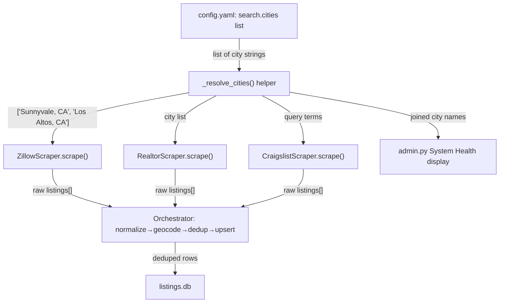

# Spec: Multi-City Scrape Territory (add Los Altos for Montclaire Elementary)

**Status:** Proposed
**Date:** 2026-07-14
**Author:** 🏗️ Architect
**Freshness:** 🟢 Fresh (<60 days)
**Related entities:** [Config (YAML)](../docs/memory/wiki/entities/config-yaml.md) · [Zillow Scraper](../docs/memory/wiki/entities/zillow-scraper.md) · [Realtor Scraper](../docs/memory/wiki/entities/realtor-scraper.md) · [Craigslist Scraper](../docs/memory/wiki/entities/craigslist-scraper.md) · [Orchestrator](../docs/memory/wiki/entities/orchestrator.md)

---

## Objective

**What:** Extend the scraper search territory beyond the single city of Sunnyvale so that rental listings near **Montclaire Elementary** (Los Altos, 94024, Loyola Corners) are fetched and stored, appearing on the dashboard alongside Sunnyvale listings.

**Why:** The user wants to catch apartments near two "green schools" the user is interested in. During scoping we verified school locations via Nominatim:

| School | Verified address | City | ZIP | In scrape territory today? |
|--------|------------------|------|-----|----------------------------|
| West Valley Elementary | 1635 Belleville Way | **Sunnyvale** | **94087** | ✅ Yes — already covered |
| Montclaire Elementary | 1160 Saint Joseph Ave, Loyola Corners | **Los Altos** | **94024** | ❌ No — needs adding |

So the actual change is **adding one city (Los Altos)** — West Valley requires nothing.

**Who:** The single primary user of SunnyNest (rental search for personal relocation).

**Success looks like:** After a scrape run, the dashboard shows Los Altos / 94024 rental listings (matching the existing price/beds filters) rendered on the map southwest of the Sunnyvale boundary overlay, near Montclaire Elementary.

### Reframed success criteria (testable)

1. `config.yaml` `search` supports a **list** of cities; Sunnyvale + Los Altos both configured.
2. A scrape run issues Zillow, Realtor, and Craigslist queries for **each** configured city.
3. At least one Los Altos (94024) listing appears in `data/listings.db` after a scrape run (given inventory exists in the price/beds band).
4. The System Health page ([`admin.py:693`](../web/routes/admin.py:693)) displays all configured cities, not just the first.
5. Existing Sunnyvale coverage is **unchanged** (no regression in listing count for Sunnyvale).
6. The Zillow/Realtor **monthly API budget guards still hold** — multi-city scraping must not blow the 500/mo (Zillow) or 100/mo (Realtor) caps unexpectedly.

---

## Tech Stack

- Python 3.11 (async scrapers, `httpx`, Playwright)
- YAML config ([`config.yaml`](../config.yaml:1)) loaded via `load_config()`
- SQLite ([`data/listings.db`](../data/listings.db)) via SQLAlchemy models
- No new dependencies required.

---

## Commands

```bash
# Run a full scrape (all sources, all cities)
.venv/bin/python scripts/run-scraper.py

# Run the scraper test suite (add multi-city tests here)
.venv/bin/python -m pytest scripts/test_*.py -v

# Verify Los Altos listings landed
.venv/bin/python -c "import sqlite3; c=sqlite3.connect('data/listings.db'); print(c.execute(\"SELECT COUNT(*) FROM listings WHERE zip_code='94024'\").fetchone())"

# Dashboard (visual verify)
.venv/bin/python -m uvicorn web.main:app --port 8000
```

---

## Project Structure (files touched)

```
config.yaml                          → search.city (scalar) → search.cities (list)
src/scrapers/zillow_scraper.py       → loop over cities in scrape()
src/scrapers/realtor_scraper.py      → loop over cities in scrape()
src/scrapers/craigslist_scraper.py   → derive query term(s) from config, not hardcoded "sunnyvale"
web/routes/admin.py                  → System Health: join cities for display
scripts/test_multi_city_scrape.py    → NEW: unit tests for city-list parsing + per-city query construction
docs/memory/wiki/entities/*.md       → wiki updates (post-implementation, by Orchestrator)
```

---

## ADR-002: Represent scrape territory as a city list, backward-compatible

**Status:** Proposed
**Date:** 2026-07-14
**Deciders:** Architect (proposing), User (approving)
**Tags:** scraping, config, api-budget

### Context

The scrape territory is defined by [`config.yaml`](../config.yaml:2) `search.city` — a **single scalar string**. Three scrapers consume it differently:

- [`zillow_scraper.py:89`](../src/scrapers/zillow_scraper.py:89) builds one `self.location = "Sunnyvale, CA"` used in every page request.
- [`realtor_scraper.py:98`](../src/scrapers/realtor_scraper.py:98) stores `self.city` and sends `location: "city:Sunnyvale, CA"`.
- [`craigslist_scraper.py:177`](../src/scrapers/craigslist_scraper.py:177) **hardcodes** `{"query": "sunnyvale"}` — it ignores `search.city` entirely.
- [`admin.py:693`](../web/routes/admin.py:693) reads `search.city` read-only for the System Health page.

`search.zip_codes` exists in config but **is not used by any scraper** — scrapers query by city name, not ZIP. So adding a ZIP alone does nothing.

Each scraper's `scrape()` loops **pages within one location**. Adding a second city requires an **outer loop over cities**, which multiplies API calls: `cities × pages`. This directly interacts with the existing monthly budget guards (Zillow 500/mo threshold 450; Realtor 100/mo threshold 90).

### Options Considered

#### Option A: `search.cities` list, backward-compatible with `search.city`
- Config gains `search.cities: ["Sunnyvale", "Los Altos"]`. A tiny config-normalization helper accepts either the old `city` scalar or the new `cities` list, always yielding a list.
- Each scraper wraps its existing page loop in `for city in self.cities:`.
- Craigslist derives its `query` term per city from the list.
- **Pros:** Clean, explicit, scales to N cities; old config files keep working; single source of truth.
- **Cons:** Touches all 3 scrapers + admin; API calls scale linearly with city count — must reconcile with budget guards.
- **Cost:** ~2–3 h Code + tests; low risk.

#### Option B: Config-only — append ", Los Altos" into the existing city string
- Set `search.city: "Sunnyvale, Los Altos"` and rely on each API to parse a comma list.
- **Pros:** Zero code change.
- **Cons:** Fragile and source-dependent — ZLLW `location` and Realtor `city:` params do **not** reliably accept multi-city strings; Craigslist ignores config anyway; corrupts the `admin.py` display and any future single-city assumption. Likely returns garbage or errors.
- **Cost:** ~0 h but high risk of silently wrong results (violates the [Silent Failure Pattern](../docs/memory/wiki/concepts/silent-failure-pattern.md)).

#### Option C: Per-city budget partition + list (A plus explicit budget split)
- Option A, plus split the monthly budget across cities (e.g., cap pages so `cities × pages ≤ remaining_budget`).
- **Pros:** Guarantees budget safety with many cities.
- **Cons:** More logic than needed for 2 cities today; premature optimization.
- **Cost:** ~4 h; medium complexity.

### Decision

We choose **Option A** (`search.cities` list, backward-compatible), with a **lightweight budget note** borrowed from C: the per-city loop MUST reuse the existing `effective_max_pages` budget-guard logic **per API call**, so the guard naturally halts pagination once the monthly threshold is hit regardless of how many cities remain. We do **not** build the full per-city partition (C) yet — 2 cities × current `max_pages` stays well under budget.

### Rationale

- Option B is rejected because it relies on unverified multi-city parsing behavior of two third-party APIs and would silently return wrong or empty results — directly against our [Silent Failure Pattern](../docs/memory/wiki/concepts/silent-failure-pattern.md) and the data-scraping skill's "partial results > wrong results" principle.
- Option A satisfies success criteria 1–5 with the least fragile mechanism and preserves backward compatibility (criterion 5, no Sunnyvale regression).
- Full budget partitioning (C) is deferred because with 2 cities the worst case (`2 × max_pages`) — Zillow `2×5=10` calls, Realtor `2×2=4` calls per run — is trivially under the monthly caps. The existing per-call guard already prevents overrun. Re-evaluate if city count grows (see review trigger).

### Consequences

**Positive:**
- Territory is now data-driven; adding future cities is a one-line config edit (once scrapers loop).
- Craigslist becomes config-driven for the first time (removes a hardcoded string — closes a latent inconsistency).
- Backward-compatible: existing `search.city` scalar still works.

**Negative:** *(mandatory)*
- **API-call volume scales linearly with city count.** Two cities roughly doubles calls per run. With current `max_pages` this is safe, but a careless future addition of many cities could exhaust the Zillow/Realtor monthly budget faster. Mitigation: the per-call budget guard still fires; add the review trigger below.
- **Cross-city deduplication surface grows.** Listings straddling the Sunnyvale/Los Altos line (e.g., the border near West Valley) could be returned by both city queries. Existing [Deduplication](../docs/memory/wiki/entities/deduplication.md) (address + lat/lng proximity, threshold ≥75) should absorb this, but it is now exercised more.
- **Boundary overlay mismatch:** Los Altos listings render **outside** the drawn [`sunnyvale-boundary.geojson`](../web/routes/api.py:31) overlay. Accepted per user confirmation; no boundary change in scope.

**Neutral:**
- `search.zip_codes` remains unused by scrapers (documentation-only). Not changed here; a future ADR could make ZIP-level filtering real.

### Dependencies
- Blocks: implementation task in this spec.
- Related entities: Zillow/Realtor/Craigslist scrapers, Config (YAML), Deduplication, Orchestrator.

### Review
- **Next review date:** 2027-01-14 (+180 days).
- **Triggers for early review:** if configured `cities` count exceeds **3**, OR if monthly Zillow calls exceed **400** — at that point implement Option C (per-city budget partition).

---

## Implementation Plan



### Phase 1 — Config + shared helper
- Change [`config.yaml`](../config.yaml:2): replace `city: Sunnyvale` with `cities: ["Sunnyvale", "Los Altos"]`; add `"94024"` to `zip_codes` (documentation consistency, even though unused by scrapers). Keep `state: CA`.
- Add a small backward-compatible resolver (accepts either `cities` list or legacy `city` scalar → always returns a list). Location: a shared util (e.g., in `src/utils.py`) so all 3 scrapers + admin import one function.

### Phase 2 — Scraper loops
- **Zillow:** wrap the page loop in `for location in self._locations:` where `_locations = [f"{c}, {state}" for c in cities]`. Reuse the existing budget guard per request (unchanged logic).
- **Realtor:** same pattern; `location: f"city:{city}, {state}"` per city.
- **Craigslist:** derive `query` per city from the list (e.g., `"sunnyvale"`, `"los altos"` lowercased) instead of the hardcoded string; run one search pass per city.

### Phase 3 — Admin display + tests
- **admin.py:** display `", ".join(cities)` for the "City" row.
- **Tests (`scripts/test_multi_city_scrape.py`):** (a) resolver accepts legacy scalar and new list; (b) each scraper builds the correct per-city query params for a 2-city config; (c) budget guard still short-circuits when threshold reached mid-city-loop.

---

## Testing Strategy

- **Framework:** pytest (matches existing `scripts/test_*.py` convention).
- **Location:** `scripts/test_multi_city_scrape.py` (new).
- **Levels:**
  - *Unit:* city resolver (scalar↔list), per-city query-param construction for all 3 scrapers, budget-guard interaction with the outer loop. **No live API calls** — mock the HTTP client / Playwright page.
  - *Manual/integration:* one real scrape run, then the ZIP-count SQL check above (criterion 3) and a visual dashboard check (criterion 4).
- **Coverage expectation:** the new resolver and the per-city param construction in each scraper must be covered. This is data-transformation logic — mandatory tests per [`.roo/rules/shared.md`](../.roo/rules/shared.md) §5.

---

## Boundaries

- **Always:** run the test suite before commit; keep `search.city` scalar working (backward compat); reuse existing budget guards untouched.
- **Ask first:** adding more than the one agreed city (Los Altos); changing `max_pages`; touching the dedup threshold; adding real ZIP-level filtering.
- **Never:** hardcode "Los Altos" anywhere in scraper code (must come from config); bypass the API budget guards; commit API keys; remove or weaken the Zillow response-side status guard from the recent stale-listing fix.

---

## Open Questions

1. **Craigslist query granularity:** Craigslist's SF Bay Peninsula search (`sfbay.craigslist.org/search/pen/apa`) already geographically covers Los Altos — a `query=los altos` term filters by text match. Acceptable, or should Craigslist stay Sunnyvale-only to avoid noisy text matches? *(Recommendation: run per-city query; dedup + the price/beds filters absorb noise. Flag for Code Reviewer.)*
2. **ZIP config:** keep adding `94024` to the (unused) `zip_codes` list for documentation parity, or leave `zip_codes` alone until it's wired to something real? *(Recommendation: add it, with a comment that it's documentation-only today.)*

---

## Wiki Impact

- **New entities:** None
- **Updated entities:**
  - [Config (YAML)](../docs/memory/wiki/entities/config-yaml.md) — `search.city` → `search.cities` list; new `94024` ZIP
  - [Zillow Scraper](../docs/memory/wiki/entities/zillow-scraper.md) — per-city loop in `scrape()`
  - [Realtor Scraper](../docs/memory/wiki/entities/realtor-scraper.md) — per-city loop in `scrape()`
  - [Craigslist Scraper](../docs/memory/wiki/entities/craigslist-scraper.md) — config-driven query (removes hardcoded `"sunnyvale"`)
  - [Admin Dashboard](../docs/memory/wiki/entities/admin-dashboard.md) — System Health shows multiple cities
- **New concepts:** None (reuses [Adapter Pattern](../docs/memory/wiki/concepts/adapter-pattern.md), [Silent Failure Pattern](../docs/memory/wiki/concepts/silent-failure-pattern.md))
