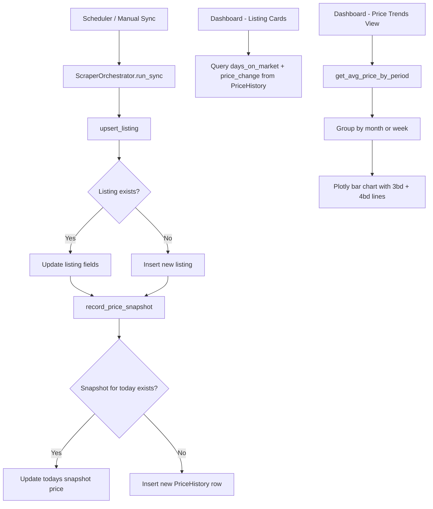
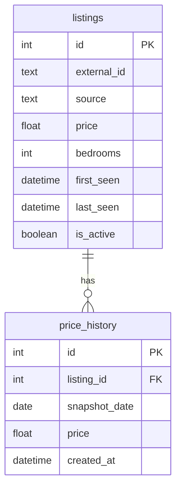

# Price History Tracking & Trends Dashboard

## Overview

Add daily price history tracking for each unique listing, surface price change indicators and days-on-market in the UI, and create a new "Price Trends" dashboard view showing average listing price per month (and week) for 3-bedroom and 4-bedroom listings.

---

## Architecture

### Data Flow



### New Table: `price_history`



---

## Detailed Implementation Steps

### 1. New `PriceHistory` Model — `src/models.py`

Add a new SQLAlchemy model alongside the existing `Listing`:

```python
class PriceHistory(Base):
    __tablename__ = "price_history"

    id = Column(Integer, primary_key=True, autoincrement=True)
    listing_id = Column(Integer, ForeignKey("listings.id"), nullable=False, index=True)
    snapshot_date = Column(Date, nullable=False)
    price = Column(Float, nullable=False)
    created_at = Column(DateTime, nullable=False, default=datetime.utcnow)

    __table_args__ = (
        UniqueConstraint("listing_id", "snapshot_date", name="uq_listing_snapshot_date"),
    )
```

- **One row per listing per day** — the unique constraint on `(listing_id, snapshot_date)` ensures we only store one price sample per day.
- The `ForeignKey` links back to `listings.id`.
- Add a `relationship` on `Listing` for convenient access: `price_history = relationship("PriceHistory", back_populates="listing", ...)`.

### 2. Database Migration — `src/database.py`

The existing `init_db()` calls `Base.metadata.create_all(engine)`, which will automatically create the new `price_history` table on startup since it's defined in `Base`. No manual migration needed — SQLAlchemy's `create_all` is additive and won't touch existing tables.

### 3. Price Snapshot Recording — `src/database.py`

Add a new function:

```python
def record_price_snapshot(listing_id: int, price: float, snapshot_date: date | None = None) -> None:
```

- Called from `upsert_listing()` after every insert or update.
- Uses `snapshot_date = snapshot_date or date.today()`.
- Performs an upsert: if a row for `(listing_id, snapshot_date)` exists, update the price; otherwise insert a new row.

### 4. Update `upsert_listing()` — `src/database.py`

After the existing insert/update logic (around line 250-263), call `record_price_snapshot(listing.id, listing.price)` to capture the daily price sample. This happens on every sync, so the price is sampled once per sync cycle.

### 5. Query Helpers — `src/database.py`

Add these new functions:

#### `get_price_history(listing_id: int) -> list[PriceHistory]`
Returns all price snapshots for a listing, ordered by date ascending. Used in the detail panel.

#### `get_listing_price_change(listing_id: int) -> dict`
Returns:
- `days_on_market`: number of days between `first_seen` and today (or last_seen if inactive)
- `price_change`: difference between current price and the first recorded price (`current - first`), positive means price went up, negative means it went down
- `price_change_pct`: percentage change

#### `get_avg_price_by_period(bedroom_counts: list[int], period: str = "monthly") -> list[dict]`
- Queries `price_history` joined with `listings` filtered by bedroom count.
- Groups by period (month or ISO week) and bedroom count.
- Returns rows like: `{period_label: "March 2026", bedrooms: 3, avg_price: 5200.0}`
- For monthly: groups by `strftime('%Y-%m', snapshot_date)`
- For weekly: groups by `strftime('%Y-W%W', snapshot_date)`

### 6. Listing Cards Enhancement — `app.py`

In the card rendering section (around line 538-613), add two new pieces of information per card:

- **Days on market**: `📅 12 days` — calculated from `first_seen` to today
- **Price change indicator**: 
  - `🔻 -$200` (red) if price dropped
  - `🔺 +$150` (green) if price went up  
  - Nothing shown if price hasn't changed or no history yet

The days-on-market can be computed directly from `listing.first_seen` without querying price history. The price change requires comparing the first snapshot price to the current price — this can be batch-loaded for all visible listings to avoid N+1 queries.

### 7. Detail Panel Enhancement — `app.py`

In the detail panel (around line 632-742), add:

- **Days on market** with the exact first-seen date
- **Price change** with dollar value and direction arrow
- **Mini price history chart** (optional, small sparkline) showing price over time if there are multiple snapshots

### 8. New "📈 Price Trends" Dashboard View — `app.py`

Add a new section after the existing "📊 Price by Bedrooms" analytics section (after line 769):

```
📈 Price Trends
[Monthly ▼ | Weekly]   ← toggle via st.radio or st.segmented_control

Bar chart:
- X-axis: time periods (March, April, May, June, July for monthly; W12, W13, ... for weekly)
- Y-axis: average listing price ($)
- Two bar series: 3-bedroom (blue) and 4-bedroom (orange)
- Rendered with Plotly (already a dependency)
```

Implementation approach:
- Use `st.radio` with `horizontal=True` for the Monthly/Weekly toggle
- Query `get_avg_price_by_period([3, 4], period)` 
- Build a Plotly `bar` chart with `barmode="group"` and two traces (3bd, 4bd)
- Color-code: blue for 3bd, orange for 4bd
- Format X-axis labels as month names for monthly view, week numbers for weekly

---

## Files Modified

| File | Changes |
|------|---------|
| `src/models.py` | Add `PriceHistory` model, add `relationship` to `Listing`, add `ForeignKey` import |
| `src/database.py` | Add `record_price_snapshot()`, `get_price_history()`, `get_listing_price_change()`, `get_avg_price_by_period()`. Update `upsert_listing()` to call `record_price_snapshot()` |
| `app.py` | Add days-on-market + price change to listing cards, add price info to detail panel, add new Price Trends section with monthly/weekly chart |

No new files are needed. No new dependencies are required (Plotly and Pandas are already in `requirements.txt`).

---

## Edge Cases & Considerations

1. **First sync**: On the very first sync, each listing gets its first `PriceHistory` row. Price change will be $0 (or not shown) since there's only one data point.

2. **Multiple syncs per day**: The unique constraint `(listing_id, snapshot_date)` ensures only one price per day. If the scraper runs multiple times per day (every 6 hours per config), the latest price wins.

3. **Inactive listings**: Price snapshots stop being recorded when a listing goes inactive (since it won't appear in scrape results). Days-on-market should use `last_seen` instead of today for inactive listings.

4. **Existing database**: The `create_all` call will add the new table without affecting existing data. Existing listings won't have price history until the next sync runs.

5. **Chart with sparse data**: If there's only data for one month, the chart will show a single bar group. The UI should handle this gracefully.
