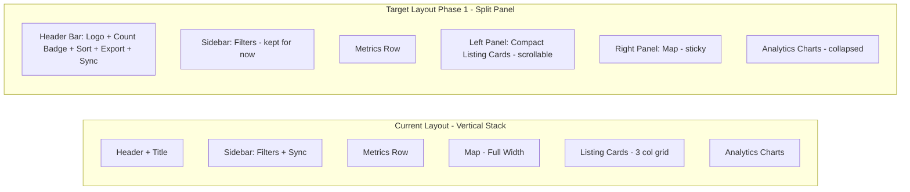

# UI Makeover Plan — Inspired by Mashvisor Property Finder

## Reference Tool Analysis

The Mashvisor Property Finder screenshots reveal a polished real estate search UI with these key patterns:
- **Split-panel layout**: listing cards on the left, interactive map on the right (side-by-side)
- **Horizontal inline filter bar** with dropdown chips instead of a sidebar
- **Map/Table view toggle** for switching between visual and data views
- **Compact property cards** with thumbnails, tags, and quick-action buttons
- **Map clustering** with unit count badges
- **Guided onboarding tour** with step-by-step tooltips
- **Save Filters / Export / Alerts** toolbar
- **Result count badge** overlaid on the map
- **Heat Map Filters** dropdown for map overlays

---

## Comprehensive Improvement Catalog

Below is every possible UI change identified, organized by category. Each item includes:
- **What**: Description of the change
- **Why**: User benefit
- **Complexity**: Low / Medium / High (implementation effort in Streamlit)
- **Priority**: P1 (high impact, do first) → P4 (nice-to-have, do later)

---

### A. Layout & Structure

| # | Improvement | What | Why | Complexity | Priority |
|---|------------|------|-----|------------|----------|
| A1 | **Side-by-side map + listings** | Place the map on the right and listing cards on the left in a split-panel layout using `st.columns` | The #1 UX pattern in real estate tools — users want to see listings and their locations simultaneously without scrolling | Medium | **P1** |
| A2 | **Map/Table view toggle** | Add toggle buttons above the content area to switch between Map View (cards + map side-by-side) and Table View (full-width sortable dataframe) | Gives users two ways to browse — visual scanning vs. data-driven comparison | Medium | **P2** |
| A3 | **Move filters from sidebar to horizontal bar** | Replace the sidebar filter panel with a horizontal filter bar using dropdown chips below the header | More screen real estate for content; modern look; filters are always visible without opening a sidebar | High | **P3** |
| A4 | **Collapsible sidebar navigation** | Add a slim icon-based vertical nav rail on the far left (like Mashvisor's dashboard/search/analytics icons) | Quick navigation between sections; professional look | High | **P4** |

### B. Header & Branding

| # | Improvement | What | Why | Complexity | Priority |
|---|------------|------|-----|------------|----------|
| B1 | **Redesigned header bar** | Create a proper top navigation bar with: app logo/title on the left, search/location input in the center, user actions (sync, settings) on the right | Cleaner visual hierarchy; looks like a real product | Medium | **P1** |
| B2 | **Result count badge** | Show a floating badge on the map or near the header showing "X of Y results" (like Mashvisor's "500 of 5979 results") | Instant feedback on how many listings match current filters | Low | **P1** |
| B3 | **Custom favicon and page title** | Update the browser tab icon and title to match the app branding | Professional polish | Low | **P2** |

### C. Property Cards

| # | Improvement | What | Why | Complexity | Priority |
|---|------------|------|-----|------------|----------|
| C1 | **Compact card design** | Redesign cards to be more compact: smaller thumbnail, single-line price, horizontal bed/bath/sqft row, tag badges | Fit more listings on screen; faster scanning | Medium | **P1** |
| C2 | **Status tags/badges** | Add colored tag badges like "New Listing" (green), "Price Drop" (red arrow down), "Pet Friendly" (paw icon) as pill-shaped badges | Quick visual scanning of key attributes | Low | **P1** |
| C3 | **Hover preview / Quick view** | Add a "Preview" button on each card that opens a modal or expander with full details (description, all images, amenities) without leaving the page | Reduces clicks; keeps user in context | Medium | **P2** |
| C4 | **Image carousel on cards** | Show multiple thumbnail images with left/right arrows on hover | Users can preview more photos without clicking through | High | **P3** |
| C5 | **Heart/favorite overlay on image** | Move the favorite button to overlay on the card thumbnail (top-right corner, like Mashvisor) | More intuitive; standard pattern | Low | **P2** |

### D. Map Enhancements

| # | Improvement | What | Why | Complexity | Priority |
|---|------------|------|-----|------------|----------|
| D1 | **Map clustering with count badges** | Re-introduce marker clustering but with count badges showing number of listings in each cluster (like Mashvisor's "3 units", "5 units" badges) | Better handling when listings overlap; cleaner map at zoom-out levels | Medium | **P2** |
| D2 | **Price labels on map markers** | Show the listing price directly on or next to each map marker (instead of only in popup) | Users can compare prices visually on the map without clicking each marker | Medium | **P2** |
| D3 | **Map marker click → highlight card** | When a user clicks a map marker, scroll to and highlight the corresponding listing card in the left panel | Connects the two views; standard real estate UX | High | **P3** |
| D4 | **Card hover → highlight map marker** | When hovering over a listing card, highlight/bounce the corresponding map marker | Bidirectional connection between list and map | High | **P3** |
| D5 | **Heat map overlay** | Add a dropdown to toggle heat map overlays (e.g., price density, school ratings) on the map | Advanced analysis capability | High | **P4** |
| D6 | **Draw-to-search on map** | Let users draw a polygon on the map to filter listings within that area | Power-user feature for geographic filtering | High | **P4** |

### E. Filtering & Search

| # | Improvement | What | Why | Complexity | Priority |
|---|------------|------|-----|------------|----------|
| E1 | **Quick filter chips** | Add clickable filter chips above the listings (e.g., "3+ Bed", "Under $5K", "Pet Friendly") that toggle on/off | One-click filtering; very fast interaction | Medium | **P2** |
| E2 | **Save filter presets** | Allow users to save their current filter combination as a named preset and reload it later | Power users who search with different criteria regularly | Medium | **P3** |
| E3 | **Sort dropdown** | Add a sort selector above listings: "Newest First", "Price: Low to High", "Price: High to Low", "Sqft: Largest" | Users want to sort by different criteria | Low | **P1** |
| E4 | **Active filter summary** | Show a row of active filter pills below the filter bar with "x" buttons to remove individual filters | Users can see and manage active filters at a glance | Low | **P2** |

### F. Data Export & Actions

| # | Improvement | What | Why | Complexity | Priority |
|---|------------|------|-----|------------|----------|
| F1 | **Export to CSV** | Add an "Export" button that downloads the current filtered listings as a CSV file | Users want to save/share data externally | Low | **P1** |
| F2 | **Compare listings** | Allow selecting 2-3 listings and viewing them side-by-side in a comparison table | Helps with decision-making between shortlisted options | Medium | **P3** |
| F3 | **Share listing link** | Generate a shareable link or copy-to-clipboard for individual listings | Users share listings with partners/roommates | Low | **P3** |

### G. Analytics & Insights

| # | Improvement | What | Why | Complexity | Priority |
|---|------------|------|-----|------------|----------|
| G1 | **Inline analytics on cards** | Show key metrics directly on listing cards (e.g., price per sqft, days on market badge) | Quick comparison without opening details | Low | **P1** |
| G2 | **Price history sparkline** | Show a tiny sparkline chart on each card showing the listing's price history over time | Instantly see if price has been dropping | Medium | **P3** |
| G3 | **Market summary dashboard** | Add a collapsible "Market Insights" section with: avg price trend, inventory count trend, avg days on market | Contextualizes individual listings within the market | Medium | **P3** |

### H. Onboarding & UX Polish

| # | Improvement | What | Why | Complexity | Priority |
|---|------------|------|-----|------------|----------|
| H1 | **Guided tour / tooltips** | Add a step-by-step onboarding tour (like Mashvisor's 1/6 through 6/6 tooltips) highlighting key features on first visit | Helps new users discover features | High | **P4** |
| H2 | **Empty state improvements** | Better empty state with illustration and actionable guidance when no listings match filters | Reduces confusion; guides user to adjust filters | Low | **P2** |
| H3 | **Loading skeletons** | Show skeleton/placeholder cards while data is loading instead of a spinner | Feels faster; more polished | Medium | **P3** |
| H4 | **Dark/Light mode toggle** | Add a theme toggle in the header | User preference; accessibility | Low | **P3** |
| H5 | **Responsive card grid** | Make the card grid responsive — 1 column on narrow screens, 2-3 on wider screens | Better experience on different screen sizes | Low | **P2** |

### I. Notifications & Alerts

| # | Improvement | What | Why | Complexity | Priority |
|---|------------|------|-----|------------|----------|
| I1 | **In-app notification bell** | Add a notification icon in the header showing count of new listings since last visit | Users see new listings without checking email | Medium | **P3** |
| I2 | **Search alerts** | Allow users to save a search and get notified when new listings match | Proactive discovery (you already have email notifier — this adds UI for it) | Medium | **P3** |

---

## Suggested Phasing

### Phase 1 — Core Layout & Quick Wins (P1 items)
Focus: Transform the fundamental layout and add high-impact, low-effort improvements.

- **A1**: Side-by-side map + listings layout
- **B1**: Redesigned header bar
- **B2**: Result count badge
- **C1**: Compact card design
- **C2**: Status tags/badges (New Listing, Price Drop, Pet Friendly)
- **E3**: Sort dropdown for listings
- **F1**: Export to CSV button
- **G1**: Inline analytics on cards (price/sqft, days on market as badge)

### Phase 2 — Enhanced Interaction (P2 items)
Focus: Add interactivity and polish to the existing layout.

- **A2**: Map/Table view toggle
- **C3**: Quick view / Preview modal
- **C5**: Heart/favorite overlay on thumbnail
- **D1**: Map clustering with count badges
- **D2**: Price labels on map markers
- **E1**: Quick filter chips
- **E4**: Active filter summary pills
- **H2**: Better empty state
- **H5**: Responsive card grid
- **B3**: Custom favicon

### Phase 3 — Power Features (P3 items)
Focus: Advanced features for power users.

- **A3**: Horizontal filter bar (replace sidebar)
- **C4**: Image carousel on cards
- **D3**: Map marker click → highlight card
- **D4**: Card hover → highlight map marker
- **E2**: Save filter presets
- **F2**: Compare listings side-by-side
- **F3**: Share listing link
- **G2**: Price history sparkline
- **G3**: Market summary dashboard
- **H3**: Loading skeletons
- **H4**: Dark/Light mode toggle
- **I1**: Notification bell
- **I2**: Search alerts UI

### Phase 4 — Premium Polish (P4 items)
Focus: Nice-to-have features that add delight.

- **A4**: Collapsible sidebar navigation rail
- **D5**: Heat map overlay
- **D6**: Draw-to-search on map
- **H1**: Guided onboarding tour

---

## Streamlit Feasibility Notes

Some items have Streamlit-specific constraints:

| Item | Constraint | Workaround |
|------|-----------|------------|
| A1 (side-by-side) | Streamlit columns work but map height needs to match card scroll area | Use `st.columns` with fixed-height containers via CSS |
| A3 (horizontal filters) | Streamlit doesn't natively support horizontal filter chips | Use `st.columns` with `st.selectbox` in each, or custom HTML/CSS |
| C4 (image carousel) | No native carousel component | Use `streamlit-carousel` package or custom HTML |
| D3/D4 (map-card sync) | Folium map events don't natively sync with Streamlit state | Use `st_folium` return value for click events; limited bidirectional sync |
| H1 (guided tour) | No native tour component | Use `streamlit-tour` package or custom JS injection |
| D6 (draw on map) | Folium Draw plugin exists but integration with Streamlit filtering is complex | Use `folium.plugins.Draw` + capture coordinates from `st_folium` return |

---

## Current vs. Target Layout Comparison

---

## Files to Modify

| File | Changes |
|------|---------|
| `app.py` | Major UI restructuring — layout, cards, header, map, export |
| `src/database.py` | Minor — add export query helper if needed |
| `requirements.txt` | Possibly add `streamlit-carousel` or other UI packages |
