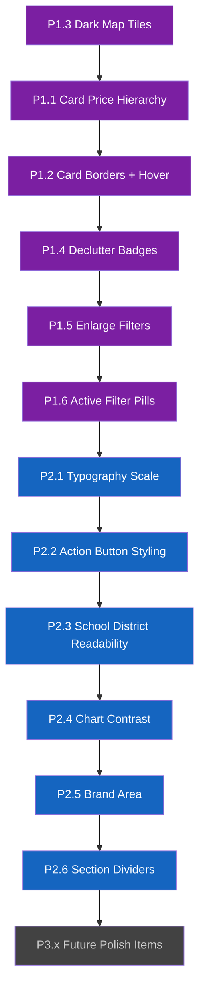

# SunnyNest UI Polish Plan

> **Scope**: Visual refinement and CSS-level polish of the existing Streamlit dark-theme dashboard.  
> **Goal**: Transform the app from "developer-built" to "consumer-grade" without restructuring the layout or adding new features.  
> **File in scope**: [`app.py`](../app.py) (all changes are CSS injections or minor HTML template edits)

---

## Current Architecture Summary

| Component | Implementation | Lines |
|-----------|---------------|-------|
| CSS injection | Single `st.markdown(<style>…</style>)` block | [67–235](../app.py:67) |
| Filter bar | 9-column `st.columns` with collapsed-label selectboxes | [341–555](../app.py:341) |
| Listing cards | Raw HTML via `st.markdown(unsafe_allow_html=True)` inside `st.container(border=True)` | [822–1028](../app.py:822) |
| Map | `folium.Map` with `DivIcon` price pills, rendered via `st_folium` | [1098–1248](../app.py:1098) |
| Charts | Plotly `go.Bar` + `go.Scatter` for Price by Bedrooms; `px.bar` for Price Trends | [1259–1392](../app.py:1259) |
| Card layout | Thumbnail `[1, 2]` columns inside each `st.container(border=True)` | [826](../app.py:826) |
| Action buttons | 4-column row `[1, 1, 2, 2]` at card bottom | [985](../app.py:985) |

---

## Issues & Improvements

### Priority 1 — High Impact, Moderate Effort

These changes will produce the most noticeable visual improvement and should be tackled first.

---

#### P1.1 — Establish Card Visual Hierarchy with Dominant Price

**Problem**: In [`_detail_col`](../app.py:847), price, beds/baths, sqft, and price/sqft all render at similar font sizes (0.85–0.95rem) with no clear scanning order. The price is styled at the same weight as bed/bath counts, making it hard to compare listings at a glance.

**Why it matters**: Price is the #1 decision factor. Users should be able to scan a column of cards and compare prices without reading any other text.

**Approach**:
- Make price the dominant element: `font-size: 1.4rem; font-weight: 700; color: #bb86fc;` on its own line
- Move beds/baths to a secondary line: `font-size: 0.9rem; font-weight: 500; color: #ccc;`
- Push sqft + price/sqft to a tertiary muted line: `font-size: 0.8rem; color: #777;`
- Add `margin-bottom: 4px` between tiers to create breathing room

**Code change**: Modify the HTML template in the [`_detail_col`](../app.py:847) block (~lines 856–876). Split the single `_price_html + _bed_bath_html` line into three separate `st.markdown` calls with distinct CSS classes.

**New CSS classes to add**:
```css
.card-price {
    font-size: 1.4rem;
    font-weight: 700;
    color: #bb86fc;
    letter-spacing: -0.3px;
    margin-bottom: 2px;
    line-height: 1.3;
}
.card-specs {
    font-size: 0.9rem;
    font-weight: 500;
    color: #ccc;
    margin-bottom: 2px;
}
.card-sqft {
    font-size: 0.8rem;
    color: #777;
    margin-bottom: 4px;
}
```

---

#### P1.2 — Improve Card Borders and Depth

**Problem**: The `st.container(border=True)` cards at [line 824](../app.py:824) use Streamlit's default thin border which nearly disappears against the dark background. Cards lack depth and feel flat.

**Why it matters**: Cards are the primary content unit. Without clear boundaries, the listing panel looks like a wall of text rather than discrete, scannable items.

**Approach**: Override the Streamlit container border styling via CSS to add a stronger border and subtle shadow.

**CSS to add**:
```css
/* Listing card containers — stronger borders + depth */
[data-testid="stVerticalBlock"] [data-testid="stContainer"][data-testid] {
    border: 1px solid rgba(255, 255, 255, 0.12) !important;
    border-radius: 10px !important;
    background: rgba(255, 255, 255, 0.03) !important;
    box-shadow: 0 2px 8px rgba(0, 0, 0, 0.25) !important;
    transition: border-color 0.2s ease, box-shadow 0.2s ease;
}

/* Hover effect — subtle glow */
[data-testid="stVerticalBlock"] [data-testid="stContainer"][data-testid]:hover {
    border-color: rgba(187, 134, 252, 0.3) !important;
    box-shadow: 0 4px 16px rgba(123, 31, 162, 0.15) !important;
}
```

**Note**: The `:hover` pseudo-class works on Streamlit containers since they are standard HTML `div` elements. This gives cards a subtle interactive feel without any JavaScript.

---

#### P1.3 — Switch Map to Dark Tiles

**Problem**: The map at [line 1102](../app.py:1102) uses default OpenStreetMap tiles which are light-themed, creating a jarring contrast with the dark UI surrounding it.

**Why it matters**: The map occupies 60% of the viewport width. A light map in a dark UI is the single most visually inconsistent element on the page.

**Approach**: Change the `folium.Map` constructor to use CartoDB Dark Matter tiles.

**Code change** at [line 1102](../app.py:1102):
```python
m = folium.Map(
    location=map_center,
    zoom_start=13,
    scrollWheelZoom=False,
    tiles="CartoDB dark_matter",  # Dark-themed map tiles
)
```

**Fallback**: If CartoDB Dark Matter has availability issues, use `"CartoDB positron"` (light grey, less jarring than OSM) or a custom Mapbox dark style via `tiles=` URL + `attr=` parameter.

---

#### P1.4 — Declutter the Badge/Tag Row

**Problem**: The tag row (lines [879–955](../app.py:879)) can display up to 6 simultaneous badges (New, price change, Pets OK, AC, Available date, Days on market). When all are present, they wrap to multiple lines and create visual noise that overwhelms the card content.

**Why it matters**: Too many badges dilute the signal. Users can't quickly identify what's important about a listing when everything is highlighted.

**Approach**:
1. **Limit visible badges to 3 max** — prioritize: price change > New > availability date. Show Pets OK and AC only if fewer than 3 higher-priority badges are present
2. **Reduce badge padding** from `2px 8px` to `1px 6px` and font-size from `0.75rem` to `0.7rem`
3. **Use muted colors for informational badges** (days ago, AC) — change from solid backgrounds to outlined style: `border: 1px solid #666; background: transparent; color: #999;`
4. **Keep solid colors only for actionable badges**: New (green), Price Drop (orange), Price Up (red)

**CSS updates** to existing classes at [lines 107–127](../app.py:107):
```css
.card-tag {
    display: inline-block;
    padding: 1px 6px;
    border-radius: 10px;
    font-size: 0.7rem;
    margin-right: 3px;
    margin-bottom: 2px;
    font-weight: 500;
    line-height: 1.4;
}

/* Informational tags — outlined style instead of solid */
.tag-days, .tag-ac, .tag-pet {
    background: transparent !important;
    border: 1px solid rgba(255, 255, 255, 0.2);
    color: #999 !important;
}

/* Freshness tags — also outlined */
.tag-fresh {
    background: transparent !important;
    border: 1px solid rgba(67, 160, 71, 0.4);
    color: #81c784 !important;
}
.tag-aging {
    background: transparent !important;
    border: 1px solid rgba(249, 168, 37, 0.4);
    color: #ffd54f !important;
}
```

**Logic change**: In the tag-building code (~lines 879–955), add a counter and skip lower-priority tags when 3+ are already present.

---

#### P1.5 — Enlarge and Group Filter Dropdowns

**Problem**: The filter selectboxes at [lines 167–171](../app.py:167) are styled at `min-height: 1.8rem` and `font-size: 0.8rem`, making them difficult to read and click, especially on high-DPI displays. All 8 filters look identical with no visual grouping.

**Why it matters**: Filters are the primary interaction mechanism. If they're hard to use, users won't filter effectively and will see irrelevant listings.

**Approach**:
1. **Increase filter height** to `2.2rem` and font-size to `0.85rem`
2. **Add subtle background tint** to group related filters: price/beds/baths get a blue-tinted background, type/source get a neutral background, view/sort get a purple-tinted background
3. **Make the reset button (✕) larger** and more visible: `font-size: 1.1rem; min-width: 2.2rem;`

**CSS updates** at [lines 167–188](../app.py:167):
```css
/* Larger, more readable filter dropdowns */
[data-testid="stHorizontalBlock"]:first-of-type [data-testid="stSelectbox"] > div > div {
    min-height: 2.2rem !important;
    padding: 0.2rem 0.5rem !important;
    font-size: 0.85rem !important;
    border-radius: 6px !important;
}

/* Reset button — more prominent */
[data-testid="stHorizontalBlock"]:first-of-type button {
    min-height: 2.2rem !important;
    font-size: 1.1rem !important;
    padding: 0 0.5rem !important;
    border-radius: 6px !important;
}
```

---

#### P1.6 — Add Active Filter Indicators

**Problem**: When filters are applied (e.g., price range changed from "Any" to "$5K–$6.5K"), there is no visual feedback in the filter bar itself. Users can't tell at a glance which filters are active.

**Why it matters**: Users frequently forget what filters they've set, leading to confusion about why certain listings aren't showing.

**Approach**: Add a compact "active filters" summary row below the filter bar, showing colored pills for each non-default filter with an × to remove it.

**Implementation**:
- After the filter bar columns (after [line 555](../app.py:555)), add a conditional `st.markdown` that renders active filter pills
- Each pill shows the filter name and value (e.g., "Price: $5K–$6.5K", "Beds: 3+")
- Style as small outlined pills matching the app's purple accent

**HTML template**:
```python
# Build active filter pills
_active_pills = []
if _price_choice != "Any Price":
    _active_pills.append(f"💰 {_price_choice}")
if _bed_choice != "🛏 Any":
    _active_pills.append(f"{_bed_choice}")
# ... etc for each filter

if _active_pills:
    _pills_html = " ".join(
        f'<span style="display:inline-block; padding:2px 8px; '
        f'border-radius:12px; font-size:0.75rem; margin-right:4px; '
        f'background:rgba(123,31,162,0.2); color:#ce93d8; '
        f'border:1px solid rgba(123,31,162,0.3);">{p}</span>'
        for p in _active_pills
    )
    st.markdown(_pills_html, unsafe_allow_html=True)
```

---

### Priority 2 — Medium Impact

These improvements add polish and readability but are less visually dramatic than P1 items.

---

#### P2.1 — Fix Typography Scale and Line Heights

**Problem**: Font sizes across the app are inconsistent. Card titles use `0.95rem` ([line 157](../app.py:157)), prices use inline `font-weight:bold` with no size override, sqft uses `0.85rem`, description uses `0.8rem`, and location uses `0.85rem`. Line heights are tight (`1.3` on descriptions at [line 133](../app.py:133)), making text feel compressed.

**Why it matters**: Consistent typography creates visual rhythm and makes content easier to scan. Tight line heights cause eye fatigue.

**Approach**: Define a clear type scale and apply it consistently:

| Element | Current | Target | CSS Class |
|---------|---------|--------|-----------|
| Card title | 0.95rem, bold | 0.95rem, 600 weight | `.card-title` |
| Price | inline bold | 1.4rem, 700 weight | `.card-price` (from P1.1) |
| Beds/baths/specs | 0.95rem bold | 0.9rem, 500 weight | `.card-specs` |
| Sqft/price-per-sqft | 0.85rem | 0.8rem, 400 weight | `.card-sqft` |
| Description | 0.8rem | 0.8rem, 400 weight, line-height 1.5 | `.card-description` |
| Location/school | 0.85rem inline | 0.78rem, 400 weight | `.card-location` |
| Tags | 0.75rem | 0.7rem, 500 weight | `.card-tag` |

**CSS additions**:
```css
/* Global line-height improvement */
.card-description {
    line-height: 1.5;  /* up from 1.3 */
}

.card-title {
    font-weight: 600;  /* semibold instead of bold */
    line-height: 1.3;
}

.card-location {
    font-size: 0.78rem;
    color: #888;
    line-height: 1.4;
}
```

---

#### P2.2 — Style Action Buttons as Icon Buttons

**Problem**: The action buttons (⭐, 👎🏻, View ↗) at [lines 985–1028](../app.py:985) are rendered as default Streamlit buttons in a 4-column layout. They're small, unstyled, and visually disconnected from the card content. The source badge in column 4 doesn't align with the buttons.

**Why it matters**: Action buttons are the primary interaction points on each card. They should feel intentional and easy to tap.

**Approach**:
1. **Reduce to 3 columns** `[1, 1, 3]` — merge the source badge into the link button column or move it to the card header area
2. **Style buttons as icon-only circles** via CSS targeting buttons inside card containers
3. **Add hover color transitions** on the favorite and dislike buttons

**CSS additions**:
```css
/* Card action buttons — icon-only circular style */
.card-action-separator + [data-testid="stHorizontalBlock"] button {
    border-radius: 50% !important;
    min-width: 2.2rem !important;
    max-width: 2.2rem !important;
    height: 2.2rem !important;
    padding: 0 !important;
    display: flex !important;
    align-items: center !important;
    justify-content: center !important;
    font-size: 1rem !important;
    transition: background-color 0.2s ease, transform 0.15s ease;
}

.card-action-separator + [data-testid="stHorizontalBlock"] button:hover {
    transform: scale(1.1);
}
```

**Alternative**: Move the source logo from the button row to the card thumbnail area (overlay in top-left corner of the image), freeing up space in the action row.

---

#### P2.3 — Improve School District Readability

**Problem**: School district text at [lines 969–979](../app.py:969) is rendered as `font-size: 0.85rem; color: #999;` — too small and too grey to read comfortably on a dark background.

**Why it matters**: For families, school district is a critical decision factor. It shouldn't be the hardest text to read on the card.

**Approach**:
- Increase color contrast: `color: #b0b0b0` (from `#999`)
- Add a subtle school icon with better spacing
- Consider rendering as a small outlined badge rather than plain text

**Code change** at [line 977](../app.py:977):
```python
st.markdown(
    f'<span class="card-location">{" · ".join(_loc_parts)}</span>',
    unsafe_allow_html=True,
)
```

With the `.card-location` class defined in P2.1 above.

---

#### P2.4 — Improve Chart Contrast and Reduce Empty Space

**Problem**: The "Price by Bedrooms" chart at [lines 1280–1327](../app.py:1280) has several issues:
- Semi-transparent blue bars (`rgba(33, 150, 243, 0.4)`) on a dark background lack contrast
- When only 2 bedroom categories exist (e.g., 3BR and 4BR), the chart has excessive whitespace
- Orange scatter dots (`size=12`) overlap when multiple listings share a bedroom count

**Why it matters**: Charts should communicate data clearly. Low contrast and wasted space undermine their purpose.

**Approach**:
1. **Increase bar opacity** from `0.4` to `0.6` and add a stronger border: `marker_line=dict(color='#64B5F6', width=2)`
2. **Set chart height explicitly** to `350px` (from Plotly's default ~450px) to reduce empty space
3. **Add jitter to scatter points** so overlapping dots spread horizontally
4. **Increase scatter dot size** from `12` to `14` and add a glow effect via `marker_line`
5. **Match chart background** to the app theme: `plot_bgcolor='rgba(30,30,46,0.5)'`

**Code changes** at [lines 1284–1327](../app.py:1284):
```python
# Bar trace — increased opacity
marker_color="rgba(33, 150, 243, 0.6)",
marker_line=dict(color="#64B5F6", width=2),

# Scatter trace — larger dots with glow
marker=dict(
    color="#FF9800",
    size=14,
    line=dict(width=2, color="rgba(255, 152, 0, 0.3)"),
    symbol="circle",
),

# Layout — tighter height, themed background
fig_bed.update_layout(
    height=350,
    plot_bgcolor="rgba(30, 30, 46, 0.5)",
    paper_bgcolor="rgba(0, 0, 0, 0)",
    margin=dict(l=50, r=20, t=30, b=40),
)
```

---

#### P2.5 — Upgrade the SunnyNest Brand Area

**Problem**: The logo at [lines 346–356](../app.py:346) is a simple `🏠` emoji + gradient text. It's functional but minimal and doesn't establish brand identity.

**Why it matters**: The brand area is the first thing users see. A more distinctive logo creates a sense of quality and trust.

**Approach**:
1. **Add a subtle tagline** below the logo: "Sunnyvale Rental Finder" in muted text
2. **Increase logo size slightly** and add a background pill shape
3. **Add the listing count** next to the logo as a badge: "12 listings"

**Updated HTML template**:
```python
st.markdown(
    '<div style="display:flex; align-items:center; gap:8px;">'
    '<span style="font-size:1.6rem; background:rgba(123,31,162,0.15); '
    'padding:4px 8px; border-radius:8px;">🏠</span>'
    '<div>'
    '<span style="font-size:1.4rem; font-weight:800; '
    'background:linear-gradient(135deg, #667eea 0%, #764ba2 100%); '
    '-webkit-background-clip:text; -webkit-text-fill-color:transparent; '
    "font-family:'Inter','Segoe UI',sans-serif; letter-spacing:-0.5px;\">"
    'SunnyNest</span>'
    f'<span style="font-size:0.7rem; color:#666; margin-left:8px;">'
    f'{len(listings)} listings</span>'
    '</div>'
    '</div>',
    unsafe_allow_html=True,
)
```

---

#### P2.6 — Replace Plain Divider with Styled Section Break

**Problem**: The `st.divider()` at [line 1253](../app.py:1253) between the listings/map panel and the charts section is a plain horizontal rule with no visual distinction.

**Why it matters**: Section transitions should feel intentional. A plain line doesn't communicate that the user is moving from "browsing" to "analytics."

**Approach**: Replace `st.divider()` with a styled section header that includes a subtle gradient line and section title.

**Code change**:
```python
st.markdown(
    '<div style="margin: 1.5rem 0 1rem 0; text-align: center;">'
    '<div style="height: 1px; background: linear-gradient(90deg, '
    'transparent, rgba(187,134,252,0.3), transparent); margin-bottom: 0.5rem;"></div>'
    '</div>',
    unsafe_allow_html=True,
)
```

---

### Priority 3 — Lower Priority / Future Enhancements

These are nice-to-have improvements that add delight but aren't critical for the initial polish pass.

---

#### P3.1 — Add Map Price Pill Shadows and Contrast

**Problem**: The purple price pill markers at [lines 1221–1235](../app.py:1221) have a basic `box-shadow: 0 2px 4px rgba(0,0,0,0.3)` but could benefit from better contrast against both light and dark map tiles.

**Approach**:
- Add a white text-shadow for readability: `text-shadow: 0 1px 2px rgba(0,0,0,0.5);`
- Increase shadow depth: `box-shadow: 0 2px 8px rgba(0,0,0,0.4);`
- Add a subtle border: `border: 1px solid rgba(255,255,255,0.15);`
- Consider using a gradient background instead of flat purple: `background: linear-gradient(135deg, #7B1FA2, #9C27B0);`

---

#### P3.2 — Add Subtle Card Image Overlay Gradient

**Problem**: Card thumbnail images at [lines 831–837](../app.py:831) have no overlay, so bright images can clash with the dark card text below them.

**Approach**: Add a bottom-fade gradient overlay on card images so the transition from image to text is smoother.

```css
/* Image overlay gradient */
[data-testid="stContainer"] img[style*="object-fit:cover"] {
    mask-image: linear-gradient(to bottom, black 70%, transparent 100%);
    -webkit-mask-image: linear-gradient(to bottom, black 70%, transparent 100%);
}
```

**Alternative**: Add the gradient via the HTML template wrapping the `` tag in a `<div>` with `position: relative` and an `::after` pseudo-element.

---

#### P3.3 — Reduce Vertical Spacing Between Filter Bar and Content

**Problem**: There's a noticeable gap between the filter bar and the listings/map panel. The CSS at [line 187](../app.py:187) sets `margin-bottom: -0.8rem` on the filter bar, but Streamlit's internal spacing still adds padding.

**Approach**: More aggressive spacing reduction:
```css
/* Tighter gap between filter bar and content */
[data-testid="stHorizontalBlock"]:first-of-type {
    margin-bottom: -1.2rem !important;
}

/* Remove padding from the main block container */
.block-container {
    padding-top: 0.1rem !important;
}
```

---

#### P3.4 — Improve Price Trends Chart Styling

**Problem**: The Price Trends grouped bar chart at [lines 1370–1392](../app.py:1370) uses Plotly Express defaults which don't match the app's dark theme. The chart has no explicit `plot_bgcolor` or `paper_bgcolor` set.

**Approach**:
```python
fig_trends.update_layout(
    plot_bgcolor="rgba(30, 30, 46, 0.5)",
    paper_bgcolor="rgba(0, 0, 0, 0)",
    height=350,
    margin=dict(l=50, r=20, t=30, b=40),
    font=dict(color="#ccc"),
    xaxis=dict(gridcolor="rgba(255,255,255,0.05)"),
    yaxis=dict(gridcolor="rgba(255,255,255,0.08)"),
)
```

---

#### P3.5 — Add Micro-Interaction to Pagination Buttons

**Problem**: The pagination buttons (Previous/Next) at [lines 1032–1052](../app.py:1032) are plain Streamlit buttons with no visual feedback beyond the default click state.

**Approach**: Add CSS transitions for hover state:
```css
/* Pagination button hover */
button[kind="secondary"]:hover {
    transform: translateY(-1px);
    box-shadow: 0 2px 8px rgba(123, 31, 162, 0.2);
    transition: all 0.2s ease;
}
```

---

#### P3.6 — Improve Empty State Design

**Problem**: The empty state at [lines 747–752](../app.py:747) is a plain `st.info()` box with minimal guidance.

**Approach**: Replace with a centered, styled empty state:
```python
st.markdown(
    '<div style="text-align:center; padding:4rem 2rem; color:#888;">'
    '<div style="font-size:3rem; margin-bottom:1rem;">🏠</div>'
    '<div style="font-size:1.2rem; font-weight:600; color:#ccc; margin-bottom:0.5rem;">'
    'No listings found</div>'
    '<div style="font-size:0.9rem;">Try adjusting your filters or click '
    '<b>🔄 Sync</b> in the sidebar to fetch new listings.</div>'
    '</div>',
    unsafe_allow_html=True,
)
```

---

## Implementation Order



**Recommended approach**: Start with P1.3 (dark map tiles) because it's a one-line change with the highest visual impact. Then work through P1.1–P1.6 as a batch since they all modify the CSS block and card templates. P2 items can be done incrementally.

---

## Files Modified

| File | Type of Change |
|------|---------------|
| [`app.py`](../app.py) | CSS injection block (lines 67–235): add/modify ~15 CSS rules |
| [`app.py`](../app.py) | Card HTML templates (lines 847–979): restructure price/specs/location rendering |
| [`app.py`](../app.py) | Map constructor (line 1102): change `tiles` parameter |
| [`app.py`](../app.py) | Tag logic (lines 879–955): add badge count limiter |
| [`app.py`](../app.py) | Chart config (lines 1280–1392): update colors, height, margins |
| [`app.py`](../app.py) | Filter bar (line 555): add active filter pills row |
| [`app.py`](../app.py) | Divider (line 1253): replace with styled section break |

No backend files are affected. This is a pure frontend/visual refactor.

---

## Design Tokens Reference

For consistency across all changes, use these values:

| Token | Value | Usage |
|-------|-------|-------|
| Accent primary | `#bb86fc` | Prices, active states, hover glows |
| Accent secondary | `#7B1FA2` | Map pills, badge backgrounds |
| Gradient | `linear-gradient(135deg, #667eea, #764ba2)` | Logo, placeholders |
| Text primary | `#ffffff` | Titles, important text |
| Text secondary | `#cccccc` | Specs, bed/bath counts |
| Text muted | `#888888` | Descriptions, locations |
| Text disabled | `#666666` | Hints, inactive elements |
| Surface | `rgba(255, 255, 255, 0.03)` | Card backgrounds |
| Border default | `rgba(255, 255, 255, 0.12)` | Card borders |
| Border hover | `rgba(187, 134, 252, 0.3)` | Card hover state |
| Shadow | `0 2px 8px rgba(0, 0, 0, 0.25)` | Card depth |
| Chart bg | `rgba(30, 30, 46, 0.5)` | Plot backgrounds |
| Border radius | `10px` cards, `12px` pills, `6px` inputs | Consistent rounding |
| Font family | `'Inter', 'Segoe UI', sans-serif` | All custom text |
