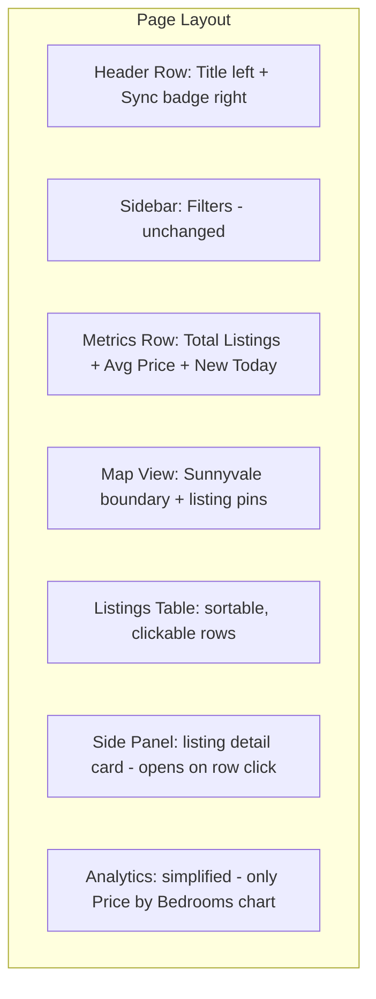
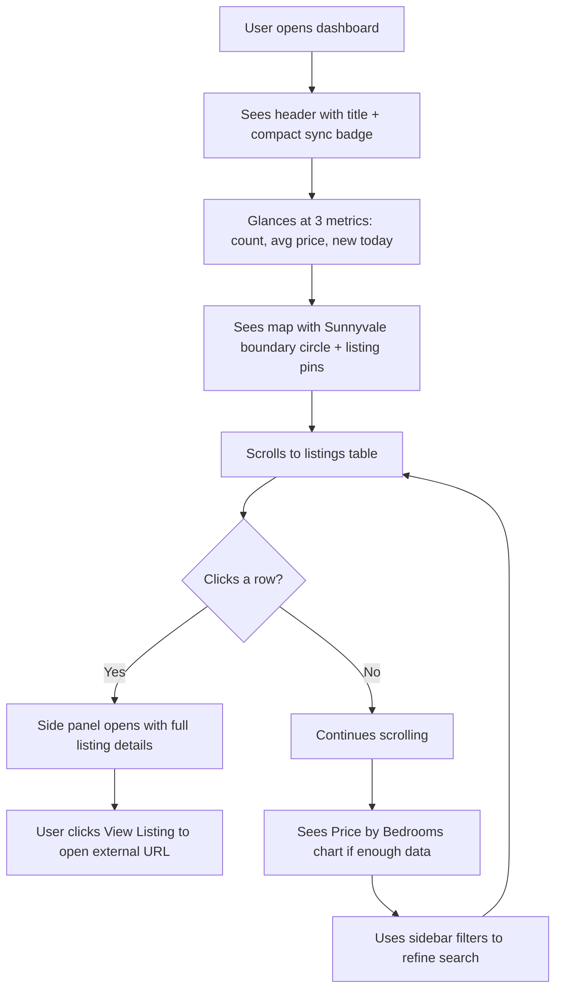

# Sunnyvale Rental Finder — UI/UX Redesign Plan

## Current Problems (from screenshot analysis)

1. **Sync details are too prominent** — "Last Sync" and "Next Sync" take up a full row with large metric cards, wasting prime real estate
2. **Median Price metric is redundant** — with only 2 listings at the same price, median = avg; even at scale, avg is sufficient for a quick glance
3. **Map is passive** — no city boundary, no listing icons, just a generic tile map with a cluster marker
4. **Listing cards are bulky** — two-column card grid doesn't scale; no way to scan many listings quickly
5. **Analytics section is heavy** — 4 tabs of charts that provide little value with a small dataset; Price Distribution and Price by Bedrooms are nearly empty
6. **Deprecated API warnings** — `use_container_width` needs to be replaced with `width` parameter
7. **Overall look is dated** — default Streamlit dark theme with no custom styling

---

## Redesigned Layout

---

## Change Specifications

### 1. Header — Compact Sync Details (top-right)

**Current**: Title on left, then a 3-column row with Sync Now button, Last Sync metric, Next Sync metric — all large.

**New**: Single header row using Streamlit columns:
- **Left (wide)**: `st.title` with app name
- **Right (narrow)**: Small text showing last/next sync times in a muted style, plus a compact "Sync Now" button

**Implementation**:
- Use `st.columns([3, 1])` for the header
- Right column: render sync times as small `st.caption` text, and a small `st.button` for sync
- Use custom CSS to reduce font size of the sync info

### 2. Remove Median Price Metric

**Current**: 4-column metrics row — Total Listings, Avg Price, Median Price, New Today.

**New**: 3-column metrics row — Total Listings, Avg Price, New Today.

**Rationale**: Median price is redundant alongside average for a personal rental search tool. The user cares about "how many listings" and "what's the going rate" — avg covers that. Median adds noise without actionable insight.

**Implementation**:
- Change `st.columns(4)` → `st.columns(3)`
- Remove the median price column entirely
- Delete the `from statistics import median` import

### 3. Enhanced Map — Sunnyvale City Boundary + Listing Icons

**Current**: Basic Folium map centered on Sunnyvale with MarkerCluster.

**New**:
- **Sunnyvale city boundary**: Draw a `folium.Circle` (or `folium.Polygon` if GeoJSON is available) around Sunnyvale center to visually delineate the search area. A circle with ~4km radius centered on downtown Sunnyvale (37.3688, -122.0363) is a practical approximation.
- **Listing markers**: Replace generic cluster markers with individual `folium.Marker` icons using `folium.Icon(icon='home', prefix='fa', color=...)` for each listing. Color-code by source (blue=Zillow, orange=Craigslist).
- **Popups**: Keep the existing popup HTML with title, price, beds, and link.
- **Remove MarkerCluster**: With a small number of listings, clustering hides information. Show individual pins directly.

**Implementation**:
- Add `folium.Circle(location=[37.3688, -122.0363], radius=4000, ...)` with a semi-transparent fill to mark Sunnyvale
- Remove `MarkerCluster` import and usage
- Keep individual `folium.Marker` with `folium.Icon(icon='home', prefix='fa')`
- Replace `use_container_width=True` with `width='stretch'` in `st_folium` call

### 4. Listings as Interactive Table + Side Detail Panel

**Current**: Two-column card grid with pagination. Each card shows all details inline.

**New**:
- **Table view**: Use `st.dataframe` (or `st.data_editor` in read-only mode) to show a sortable, scannable table with columns: Title, Price, Beds, Baths, Sqft, Neighborhood, Source, Listed Date
- **Row selection**: Use Streamlit's `on_select` callback or `st.dataframe` selection events to detect which row the user clicks
- **Side panel**: When a row is selected, display a detailed card in a right-side panel (using `st.columns([2, 1])` split or `st.sidebar` secondary area) showing:
  - Full title
  - Price (large)
  - Beds / Baths / Sqft
  - Neighborhood & School District
  - Amenities (pet friendly, parking, laundry, AC, furnished)
  - Description text
  - Image gallery link
  - "View Listing" external link button
  - First seen / Last seen dates

**Implementation approach**:
- Build a `pandas.DataFrame` from the listings
- Render with `st.dataframe(df, on_select='rerun', selection_mode='single-row')` 
- On selection, read the selected row index from the returned selection state
- Render the detail card in a right column or an expander below the table
- Alternative: use `st.columns([3, 2])` — left column has the table, right column has the detail card (appears when a listing is selected)

### 5. Streamlined Analytics

**Current**: 4 tabs — Price Analysis (histogram + box plot), Trends (line chart), By Category (pie charts + bar chart), Value (price per sqft histogram).

**UX Assessment**:
| Chart | Value to User | Verdict |
|-------|--------------|---------|
| Price Distribution histogram | Low — user already sees prices in the table | **Remove** |
| Price by Bedrooms box plot | Medium — helps compare 3BR vs 4BR pricing | **Keep** |
| New Listings Over Time | Low — only useful after weeks of data collection | **Remove for now** |
| Listings by Source pie | Low — user can see source in the table | **Remove** |
| Listings by Property Type pie | Low — same as above | **Remove** |
| Listings by Neighborhood bar | Low — visible in table | **Remove** |
| Price per Sqft histogram | Low — not enough data, and $/sqft can be a table column | **Remove** |

**New analytics section**: 
- Single section (no tabs) with just the **Price by Bedrooms** box plot — this is the only chart that provides insight not easily gleaned from the table itself (statistical distribution across bedroom counts).
- Render it in a compact container below the listings table.
- If there are fewer than 3 listings, hide the analytics section entirely.

### 6. Modern Styling with Custom CSS

Apply custom CSS via `st.markdown(unsafe_allow_html=True)` to:
- Reduce padding on metric cards
- Style the sync info as a subtle badge
- Add subtle card borders and shadows to the detail panel
- Use a cleaner font hierarchy
- Tighten spacing between sections

### 7. Fix Deprecated Warnings

Replace all `use_container_width=True` with `width='stretch'` and `use_container_width=False` with `width='content'` across:
- `st.plotly_chart()` calls
- `st_folium()` call

---

## New Page Flow (User Journey)

---

## Files to Modify

| File | Changes |
|------|---------|
| [`app.py`](app.py) | Complete dashboard rewrite — header, metrics, map, table, side panel, analytics, CSS |

No changes needed to backend files ([`src/models.py`](src/models.py), [`src/database.py`](src/database.py), [`src/scrapers/`](src/scrapers/), etc.) — this is a pure frontend/UI refactor.

---

## Summary of Removals
- Median Price metric
- MarkerCluster (replaced with individual markers)
- Listing card grid (replaced with table + side panel)
- Analytics tabs: Price Distribution, Trends, By Category, Value (Price per Sqft)
- `from statistics import median` import

## Summary of Additions
- Compact sync badge in header top-right
- Sunnyvale city boundary circle on map
- Individual home icon markers on map
- Sortable listings table with row selection
- Side detail panel for selected listing
- Custom CSS for modern look
- `width='stretch'` parameter (replacing deprecated `use_container_width`)
